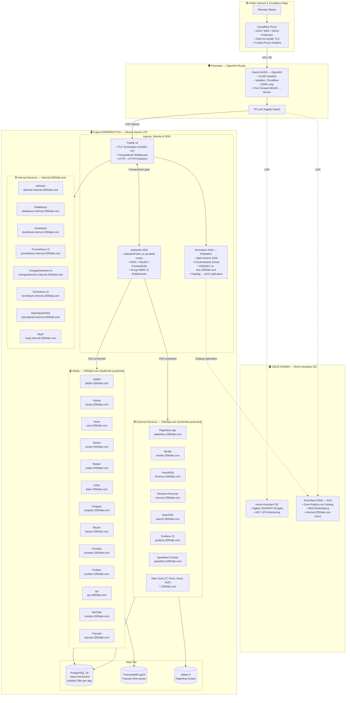

<div align="center">

# 205hlab

**Production Homelab Infrastructure & Engineering Portfolio**

[](https://github.com/Dr20Ervin/205hlab/releases)
[](LICENSE)
[](https://ubuntu.com)
[](https://docs.docker.com/compose/)
[](https://traefik.io)
[](https://goauthentik.io)
[](https://www.cloudflare.com)
[](https://www.postgresql.org)
[](https://grafana.com)
[](https://prometheus.io)

<br/>

**[📖 Architecture](#-system-architecture) · [🌐 Routing & DNS](#-routing--dns-design) · [📦 Services](#-service-catalog) · [🔒 Security](#-security-posture) · [📁 Structure](#-repository-structure) · [🚀 Deployment](#-deployment--operations)**

<br/>

> *Snapshot Release `2026-11-14` — Production architecture baseline, actively running in my home 24/7.*

</div>

---

> [!NOTE]
> **On AI-Assisted Documentation**
> All code, configurations, and infrastructure design in this repository were **written and engineered by me**. AI tooling was used exclusively for repetitive, non-creative tasks — such as standardizing formatting across compose files, cross-checking for missing environment variables, and drafting documentation from my own notes and descriptions. Every architectural decision, service selection, security design, and line of configuration reflects my own work and understanding. This README and accompanying docs were written with AI assistance to accelerate documentation — the production infrastructure itself was not.

---

## 📌 About This Repository

This repository serves a **dual purpose**:

**Engineering Portfolio** — A tangible, real-world showcase of systems architecture, container orchestration, defense-in-depth security, infrastructure automation, and observability engineering. Everything here is what I personally architect, deploy, debug, and maintain.

**Live Production Homelab** — The operational backbone powering day-to-day self-hosted digital services, media automation, household productivity tools, and smart home infrastructure. This is not a demo — these stacks are online right now, serving my household daily.

Every service is governed by production-grade standards: hard CPU/RAM resource limits, Docker healthchecks, network microsegmentation, automated TLS lifecycle management, **mandatory centralized SSO/ForwardAuth on every WAN-facing route**, and end-to-end Prometheus telemetry piped into Grafana dashboards.

---

## 🧠 Skills & Engineering Background

While this repository focuses on **containerized infrastructure running on bare-metal Ubuntu Server**, my homelab journey spans years of hands-on enterprise and virtualization experience across the full infrastructure stack:

<details>
<summary><strong>🖥️ Virtualization & Hypervisors</strong></summary>
<br/>

Deep experience architecting and operating **Proxmox VE** clusters — including KVM virtual machines, unprivileged LXC containers, PCI/GPU hardware passthrough, Software-Defined Networking (SDN with VLANs and VNet overlays), and automated backup workflows with Proxmox Backup Server (PBS). Comfortable managing full cluster HA fencing and live VM migration.

</details>

<details>
<summary><strong>🗄️ Enterprise Storage & OpenZFS</strong></summary>
<br/>

Designing and operating high-integrity ZFS storage pools on **TrueNAS (Core & SCALE)** — including vdev topology selection (RAID-Z1/Z2/Z3, mirrored vdevs), dataset recordsize tuning per workload, L2ARC/ZIL SSD tiering, automated snapshot schedules, remote ZFS replication over SSH, and periodic bit-rot scrubbing for data integrity assurance.

</details>

<details>
<summary><strong>🔐 Identity & Access Management (IAM)</strong></summary>
<br/>

Enterprise foundation built on **Windows Server Active Directory Domain Services (AD DS)** (GPO, DNS, DHCP, Kerberos, Group Policy) and Red Hat-ecosystem **FreeIPA** (LDAP directory, Kerberos KDC, integrated CA/PKI, host-based access control). Currently evolved into a cloud-native, zero-trust SSO architecture driven by **Authentik** — providing OIDC, OAuth2, ForwardAuth middleware integration, custom group/entitlement RBAC, and automated user lifecycle management for all homelab services.

</details>

<details>
<summary><strong>🌐 Reverse Proxy, TLS & Traffic Engineering</strong></summary>
<br/>

Advanced ingress routing with **Traefik Proxy v3** — dynamic configuration via Docker and file providers, middleware chaining (ForwardAuth, headers, rate limiting), automated Let's Encrypt certificate lifecycle via **Cloudflare DNS-01 ACME challenges** (no port 80 exposure required), Prometheus metrics export, and robust health endpoint monitoring.

</details>

<details>
<summary><strong>🛡️ Perimeter Security & Network Hardening</strong></summary>
<br/>

Multi-tier ingress protection combining **Cloudflare Proxy** at the edge with strict host-level **`iptables`/`nftables`** rules on the Ubuntu Server. The firewall enforces that only verified **Cloudflare origin IP blocks** and internal LAN/VLAN CIDRs can reach open ports — making the server completely immune to internet port scanners and direct-to-IP exploitation attempts even if the DNS record is publicly resolvable. Combined with Cloudflare's WAF, bot mitigation, and DDoS protection.

</details>

<details>
<summary><strong>📡 Custom Network Firmware & Routing</strong></summary>
<br/>

Custom-compiled **OpenWrt** flashed on a **Xiaomi Redmi Router AX6S** — handling core LAN routing, VLAN isolation between IoT, trusted, and management zones, firewall zone-based policy enforcement, hardware NAT acceleration, DHCP/DNS request interception, and WAN port forwarding with strict source validation.

</details>

<details>
<summary><strong>🏠 Smart Home & Automation Infrastructure</strong></summary>
<br/>

Home automation decoupled from the main compute host onto a dedicated, isolated appliance running **Home Assistant OS (HAOS)**. This design ensures that IoT integrations, Zigbee/Z-Wave mesh management, and local automations are resilient and do not share blast radius with server maintenance. The HAOS server also hosts the **auxiliary Technitium DNS instance** (see [DNS Design](#-routing--dns-design)), providing redundancy for internal name resolution across the network.

</details>

<details>
<summary><strong>🐳 Container Systems Engineering</strong></summary>
<br/>

Declarative, multi-stack **Docker Compose** configurations governed by least-privilege security principles: non-root `PUID`/`PGID` user namespace mappings, `no-new-privileges:true` security options, read-only Docker socket mounts, deterministic CPU/RAM resource caps, isolated bridge networks per domain, and comprehensive Docker healthchecks on every service.

</details>

---

## 🖥️ Physical Infrastructure

### Primary Production Server — Fujitsu ESPRIMO P710

| Component | Specification |
| :--- | :--- |
| **Case & Form Factor** | Fujitsu ESPRIMO P710 (Tower) |
| **CPU** | Intel Core i7-3770 (4C/8T, 3.2 GHz base / 3.6 GHz boost) |
| **RAM** | 32 GB DDR3 |
| **OS Drive** | 1× 240 GB Kingston A400 SSD (Ubuntu Server LTS) |
| **Data Drive** | 1× 480 GB ADATA SU630 SSD (`/srv` — Docker volumes & app data) |
| **Media Pool** | 2× 4 TB Hitachi Enterprise HDDs (OpenZFS mirrored pool — bulk media) |
| **NIC** | TP-Link TG-3468 Gigabit PCI-e |
| **iGPU (Transcoding)** | Intel HD Graphics 4000 — exposed as `/dev/dri` for Jellyfin VAAPI |
| **Host OS** | Ubuntu Server LTS |

### HAOS / Smart Home + Auxiliary DNS — ASUS X540SA

| Component | Specification |
| :--- | :--- |
| **Platform** | ASUS X540SA laptop |
| **CPU** | Intel Celeron N3060 (2C/2T, low-power) |
| **RAM** | 4 GB DDR3 |
| **Storage** | 1× 240 GB Kingston A400 SSD |
| **Connected Devices** | SONOFF Zigbee 3.0 USB Dongle Plus · APC Back-UPS XS 950U (USB) |
| **Services Running** | Home Assistant OS (HAOS) + **Auxiliary Technitium DNS** (`technitium-aux`) |
| **DNS Role** | Receives zone replication from primary Technitium via Catalog zone — provides DNS redundancy for the internal homelab network |

### Network Infrastructure

| Device | Role |
| :--- | :--- |
| **Xiaomi Redmi Router AX6S** | Primary router — custom-compiled **OpenWrt**, VLANs, firewall zones, port forwarding, hardware NAT |
| **TP-Link 5-Port Gigabit Switch** | Unmanaged gigabit switching for wired LAN segments |
| **Cloudflare** | Edge proxy, CDN, WAF, DNS, and ACME DNS-01 TLS certificate automation |

---

## 🏗️ System Architecture



---

## 🌐 Routing & DNS Design

### Subdomain Strategy — Internal vs. External

A key design decision in this homelab is the **split between internal-only and externally-accessible services**, enforced at both the DNS and Traefik routing layers:

| Subdomain Pattern | Access | Protection | Description |
| :--- | :--- | :--- | :--- |
| `*.205hlab.com` | 🌐 **Internet + LAN** | 🔒 **Authentik mandatory** | Services accessible from WAN. Every single route is protected by Authentik ForwardAuth middleware or native OIDC SSO — no anonymous access under any circumstance. |
| `*.internal.205hlab.com` | 🏠 **LAN only** | 🏠 LAN-restricted + Authentik | Management and infrastructure UIs. Only resolvable on the internal network via Technitium's authoritative `internal.205hlab.com` zone. The subdomain does not exist in public DNS. |

### Traefik Route Map

#### 🔒 Internal Services (`*.internal.205hlab.com`)

> These hostnames exist **only** in the internal `internal.205hlab.com` Technitium DNS zone. They are not resolvable from the internet.

| Traefik Route | Service | Stack |
| :--- | :--- | :--- |
| `adminer.internal.205hlab.com` | Database web UI | [`postgres`](compose/postgres/) |
| `changedetection.internal.205hlab.com` | Change monitoring | [`changedetection`](compose/changedetection/) |
| `databasus.internal.205hlab.com` | Database management interface | — |
| `dockhand.internal.205hlab.com` | Docker container management | — |
| `myip.internal.205hlab.com` | IP & DNS leak diagnostics (ForwardAuth) | [`network-mon`](compose/network-mon/) |
| `openspeed.internal.205hlab.com` | HTML5 LAN speed test server | [`network-mon`](compose/network-mon/) |
| `prometheus.internal.205hlab.com` | Prometheus TSDB | [`prometheus`](compose/prometheus/) |
| `technitium.internal.205hlab.com` | Technitium DNS admin UI | [`technitium`](compose/technitium/) |

#### 🌐 External Services (`*.205hlab.com`) — All Protected by Authentik

> Every WAN-facing route is **mandatorily gated** behind Authentik — either as Traefik `ForwardAuth` middleware or native OIDC SSO integration. No unauthenticated access is possible.

| Traefik Route | Service | Auth Method | Stack |
| :--- | :--- | :--- | :--- |
| `authentik.205hlab.com` | Authentik SSO | — (is the IdP) | [`authentik`](compose/authentik/) |
| `bazarr.205hlab.com` | Bazarr subtitles | ForwardAuth | [`servarr`](compose/servarr/) |
| `chaptarr.205hlab.com` | Chaptarr books & audiobooks | ForwardAuth | [`servarr`](compose/servarr/) |
| `draw.205hlab.com` | Draw.io architecture diagrams | ForwardAuth | [`web-tools`](compose/web-tools/) |
| `freshrss.205hlab.com` | FreshRSS reader | OIDC (native) | [`freshrss`](compose/freshrss/) |
| `grafana.205hlab.com` | Grafana dashboards | OIDC (native) | [`grafana`](compose/grafana/) |
| `it-tools.205hlab.com` | IT-Tools developer utilities | ForwardAuth | [`web-tools`](compose/web-tools/) |
| `jellyfin.205hlab.com` | Jellyfin media server | OIDC (SSO Plugin) | [`jelly`](compose/jelly/) |
| `kavita.205hlab.com` | Kavita digital library & reader | OIDC (native) | [`kavita`](compose/kavita/) |
| `lidarr.205hlab.com` | Lidarr music | ForwardAuth | [`servarr`](compose/servarr/) |
| `mealie.205hlab.com` | Mealie recipes | OIDC (native) | [`mealie`](compose/mealie/) |
| `metube.205hlab.com` | MeTube downloader | ForwardAuth | [`downloaderr`](compose/downloaderr/) |
| `omni.205hlab.com` | Omni-Tools Swiss Army utilities | ForwardAuth | [`web-tools`](compose/web-tools/) |
| `paperless.205hlab.com` | Paperless-ngx docs | OIDC (native) | [`paperless`](compose/paperless/) |
| `pdf.205hlab.com` | BentoPDF client-side WASM toolkit | ForwardAuth | [`web-tools`](compose/web-tools/) |
| `profilarr.205hlab.com` | Profilarr profiles | OIDC (native) | [`servarr`](compose/servarr/) |
| `prowlarr.205hlab.com` | Prowlarr indexers | ForwardAuth | [`servarr`](compose/servarr/) |
| `qui.205hlab.com` | qui qBittorrent UI | OIDC (native) | [`downloaderr`](compose/downloaderr/) |
| `radarr.205hlab.com` | Radarr movies | ForwardAuth | [`servarr`](compose/servarr/) |
| `resume.205hlab.com` | Reactive Resume | OIDC (native) | [`reactive-resume`](compose/reactive-resume/) |
| `search.205hlab.com` | SearXNG metasearch | ForwardAuth | [`searxng`](compose/searxng/) |
| `seer.205hlab.com` | Seerr requests | ForwardAuth | [`jelly`](compose/jelly/) |
| `sonarr.205hlab.com` | Sonarr TV | ForwardAuth | [`servarr`](compose/servarr/) |
| `speedtest.205hlab.com` | Speedtest Tracker | ForwardAuth | [`network-mon`](compose/network-mon/) |
| `tracearr.205hlab.com` | Tracearr analytics | ForwardAuth | [`tracearr`](compose/tracearr/) |

---

### 🧭 Technitium DNS — Dual-Instance Architecture

The homelab runs **two Technitium DNS servers** providing redundancy and split-horizon resolution across the entire network:

```
┌─────────────────────────────────────┐    Catalog Zone Replication
│  PRIMARY — Ubuntu Server (Docker)   │ ──────────────────────────────► ┌─────────────────────────────────┐
│  technitium.internal.205hlab.com    │                                  │  AUX — HAOS (ASUS X540SA)       │
│  Ports: 53/tcp, 53/udp              │                                  │  technitium-aux                 │
│  Admin: :5380 (management VLAN only)│                                  │  Receives replicated zones      │
└─────────────────────────────────────┘                                  └─────────────────────────────────┘
```

**Primary server** (Docker on Ubuntu Server) is authoritative for all zones and serves recursive queries for the LAN. **Auxiliary server** (native on HAOS) receives zone replicas via the Technitium Catalog mechanism — meaning if the primary server goes down for maintenance, the auxiliary continues resolving all internal hostnames without manual zone configuration.

#### DNS Zones

| Zone | Type | DNSSEC | Purpose |
| :--- | :--- | :--- | :--- |
| `205hlab.com` | Forwarder | — | Forwards public zone queries upstream (Cloudflare) while allowing internal override |
| `internal.205hlab.com` | Primary | — | Authoritative for all `*.internal.205hlab.com` hostnames — **internal services only** |
| `dns.205hlab.com` | Primary | ✅ DNSSEC | DNS server host records, signed with DNSSEC |
| `lan.205hlab.com` | Primary | — | LAN device hostname records |
| `mngt.205hlab.com` | Primary | — | Management interface records (Proxmox, switches, router, IPMI) |
| `cluster-catalog.dns.205hlab.com` | Catalog | — | Technitium Catalog zone — drives automatic zone replication to the AUX server |
| `0.10.10.in-addr.arpa` | Primary | — | Reverse DNS for `10.10.0.0/24` (LAN subnet) |
| `0.14.10.in-addr.arpa` | Primary | — | Reverse DNS for `10.14.0.0/24` (management subnet) |

**Key DNS features:**
- **Split-horizon**: `internal.205hlab.com` and `lan.205hlab.com` zones exist only internally. Clients on the LAN resolve `service.internal.205hlab.com` to the server's LAN IP; external DNS has no record of these hostnames.
- **DNSSEC**: The `dns.205hlab.com` zone is DNSSEC-signed, providing cryptographic zone integrity.
- **Ad/malware blocking**: Network-wide DNS-layer filtering enforced at the resolver level.
- **Forwarders**: `1.1.1.1` (Cloudflare) and `9.9.9.9` (Quad9) as upstream resolvers for non-local queries.
- **Catalog-driven replication**: Zone changes on the primary are automatically propagated to the auxiliary — zero manual zone management on the HAOS server.

---

## 📦 Service Catalog

### 🔀 Ingress, TLS & Identity

| Stack | Image | Description |
| :--- | :--- | :--- |
| [`traefik`](compose/traefik/) | `traefik:v3.7.18` | Core reverse proxy. All HTTPS termination, Cloudflare DNS-01 ACME certificates, automatic HTTP→HTTPS redirect, ForwardAuth middleware chaining across all protected routes, Prometheus metrics on `:9090`, and health probe on `:8082`. Trusted proxy CIDRs locked to Cloudflare IP blocks + internal subnet. |
| [`authentik`](compose/authentik/) | `goauthentik/server:2026.8.5` | Centralized Identity Provider (IdP). **Every WAN-facing service routes through Authentik** — either as a Traefik ForwardAuth middleware gate or via native OIDC SSO integration. Provides OIDC discovery, OAuth2 authorization, email dispatch, and fine-grained entitlement/group RBAC. |
| [`technitium`](compose/technitium/) | `technitium/dns-server:15.6.2` | **Primary** Technitium DNS server. Authoritative for 8 internal zones, split-horizon resolution, DNSSEC on `dns.205hlab.com`, ad/malware blocking, and Catalog-driven replication to the auxiliary instance on HAOS. |
| HAOS (native) | `technitium/dns-server` | **Auxiliary** Technitium DNS server running natively on the ASUS X540SA HAOS appliance. Receives all zone replicas from the primary via the Catalog zone — provides DNS continuity during primary server maintenance windows. |

### 🗄️ Centralized Data Tier

| Stack | Image | Description |
| :--- | :--- | :--- |
| [`postgres`](compose/postgres/) | `postgres:18.3` | Central relational database with `--data-checksums` for silent corruption detection. Each application gets an isolated database user provisioned via `db-init.sql`. Shared by: Authentik, Mealie, Paperless, FreshRSS, Servarr (\*arr suite incl. Chaptarr), qui, Tracearr, Reactive Resume, Speedtest Tracker. |
| [`postgres`](compose/postgres/) | `adminer:latest` | Web-based DB admin UI at `adminer.internal.205hlab.com` — LAN-only access. |
| [`tracearr`](compose/tracearr/) | `timescale/timescaledb-ha:pg18.4-ts2.29.1` | Dedicated TimescaleDB time-series cluster for Tracearr analytics. Custom `max_locks_per_transaction`, `max_connections`, and telemetry-off configuration. Paired with Redis 8 for task queuing. |
| [`paperless`](compose/paperless/) | `valkey/valkey:9-alpine` | Valkey (open-source Redis fork v9) broker powering Paperless-ngx background task and document processing queues. |
| [`reactive-resume`](compose/reactive-resume/) | `valkey/valkey:9-alpine` | Dedicated Valkey (open-source Redis fork v9) broker powering Reactive Resume live resume subscriptions, shared rate limits, and state resilience. |
| [`searxng`](compose/searxng/) | `valkey/valkey:9-alpine` | Dedicated Valkey (open-source Redis fork v9) broker powering SearXNG metasearch query caching and engine rate-limiting over loopback. |

### 🏗️ Infrastructure & Management (Internal)

| Service | URL | Description |
| :--- | :--- | :--- |
| **Dockhand** | `dockhand.internal.205hlab.com` | Docker container management UI — deploy, monitor, and manage containers with a web interface. Authentik ForwardAuth protected. Compose stack not yet published in this repo. |
| **Databasus** | `databasus.internal.205hlab.com` | Database management interface for internal DB operations. LAN-only. |

### 📊 Observability, Telemetry & Health

| Stack | Image | URL | Description |
| :--- | :--- | :--- | :--- |
| [`prometheus`](compose/prometheus/) | `prom/prometheus:v3.11.3` | `prometheus.internal.205hlab.com` | Central time-series monitoring engine. 30-day retention, 50 GB storage cap. Internal-only access. |
| [`grafana`](compose/grafana/) | `grafana/grafana:13.0.1` | `grafana.205hlab.com` | Visualization platform. Authentik OAuth2/OIDC login with entitlement-based RBAC (`Grafana Admins`, `Grafana Editors`, `Viewer`). |
| [`prom-exporters`](compose/prom-exporters/) | node-exporter · cadvisor · postgres-exporter · technitium-exporter · zfs-exporter · smartctl-exporter | internal | Host hardware telemetry, container cgroup metrics, PostgreSQL stats, DNS query rates, OpenWrt router stats, APC UPS metrics, ZFS pool states, and physical drive S.M.A.R.T. health. |

**Pre-provisioned Grafana dashboards** in [`grafana-dashboards/`](grafana-dashboards/):

| Folder | Dashboards |
| :--- | :--- |
| [`core/`](grafana-dashboards/core/) | Authentik · cAdvisor (Containers) · PostgreSQL · Technitium DNS · Traefik · Speedtest Tracker |
| [`hardware/`](grafana-dashboards/hardware/) | Node Exporter (Full Host) · APC UPS · OpenWrt Router · OpenZFS / Storage |
| [`saas/`](grafana-dashboards/saas/) | qui / qBittorrent torrent metrics |

### 🌐 Network Performance & Diagnostics

| Stack | Image | URL | Auth | Description |
| :--- | :--- | :--- | :--- | :--- |
| [`network-mon`](compose/network-mon/) | `linuxserver/speedtest-tracker:latest` | `speedtest.205hlab.com` | ForwardAuth | Automated Ookla/Speedtest CLI runs, latency/jitter trend graphs, and Prometheus metric export. Optimal 3-hour scheduling (`23 */3 * * *`) captures 24h ISP performance trends without saturating streaming bandwidth. Backed by PostgreSQL 18. |
| [`network-mon`](compose/network-mon/) | `openspeedtest/latest` | `openspeed.internal.205hlab.com` | LAN-only | Pure HTML5 in-LAN speed test server benchmarking raw gigabit switch and OpenWrt router throughput without consuming external WAN quota. Binds direct host ports on `${LAN_IP}:3000` and `${MNGT_IP}:3000` to bypass reverse proxy overhead when testing switches. |
| [`network-mon`](compose/network-mon/) | `jason5ng32/myip:latest` | `myip.internal.205hlab.com` | ForwardAuth | Self-hosted IP, DNS, and WebRTC leak detection dashboard with direct access on `${MNGT_IP}:18966` for management VLAN diagnostics. |

### 🏠 Household SaaS & Productivity

| Stack | Image | URL | Auth |
| :--- | :--- | :--- | :--- |
| [`paperless`](compose/paperless/) | `paperless-ngx` + `gotenberg:8.37` + `tika:3.3.1.0` | `paperless.205hlab.com` | OIDC native |
| [`mealie`](compose/mealie/) | `mealie-recipes/mealie:latest` | `mealie.205hlab.com` | OIDC native |
| [`freshrss`](compose/freshrss/) | `freshrss/freshrss:1.30.4` | `freshrss.205hlab.com` | OIDC native |
| [`reactive-resume`](compose/reactive-resume/) | `amruthpillai/reactive-resume:latest` + `valkey:9-alpine` | `resume.205hlab.com` | OIDC native |
| [`searxng`](compose/searxng/) | `searxng:latest` + `gluetun:v3.41.3` + `valkey:9-alpine` | `search.205hlab.com` | ForwardAuth |
| [`changedetection`](compose/changedetection/) | `changedetection.io` + `sockpuppetbrowser` | `changedetection.internal.205hlab.com` | LAN-only |
| [`web-tools`](compose/web-tools/) | `corentinth/it-tools:latest` | `it-tools.205hlab.com` | ForwardAuth |
| [`web-tools`](compose/web-tools/) | `iib0011/omni-tools:latest` | `omni.205hlab.com` | ForwardAuth |
| [`web-tools`](compose/web-tools/) | `jgraph/drawio:latest` | `draw.205hlab.com` | ForwardAuth |
| [`web-tools`](compose/web-tools/) | `ghcr.io/alam00000/bentopdf-simple:latest` | `pdf.205hlab.com` | ForwardAuth |

> **Paperless-ngx** runs a full document processing pipeline: Apache Tika extracts text from Office/PDF files, Gotenberg handles PDF rendering with sandboxed Chromium, and Valkey queues all background OCR and classification tasks.

> **FreshRSS** serves a dual role: personal news aggregator and the homelab's **Infrastructure Release Sentinel**. It tracks upstream GitHub release feeds across all 20+ container stacks via a version-controlled **Dynamic OPML** architecture ([`compose/freshrss/rss-feeds/`](compose/freshrss/rss-feeds/)), providing an early-warning radar for security patches, feature changes, and breaking configurations before triggering container updates in **Dockhand** or running manual infrastructure migrations.

> **SearXNG** is a privacy-respecting metasearch engine. Outbound scraping exits through a dedicated **Gluetun WireGuard VPN** tunnel (`network_mode: service:gluetun-search`, AirVPN provider) to eliminate residential IP rate-limits and CAPTCHAs, with query caching and engine rate limits backed by a local **Valkey 9** instance over loopback.

> **Web Tools** hosts purely client-side, zero-state engineering and document utilities (**IT-Tools**, **Omni-Tools**, **Draw.io**, and **BentoPDF**). All processing (regex parsing, token decoding, diagramming, and PDF manipulation) executes locally in the browser via JavaScript/WebAssembly with `read_only: true` root filesystems, `no-new-privileges:true`, and Authentik ForwardAuth protection to prevent query/context leakage to public SaaS providers.

### 🎬 Media Automation & Delivery

| Stack | Image | URL | Auth |
| :--- | :--- | :--- | :--- |
| [`jelly`](compose/jelly/) | `linuxserver/jellyfin:latest` | `jellyfin.205hlab.com` | OIDC (SSO Plugin) |
| [`jelly`](compose/jelly/) | `seerr-team/seerr:latest` | `seer.205hlab.com` | ForwardAuth |
| [`kavita`](compose/kavita/) | `linuxserver/kavita:latest` | `kavita.205hlab.com` | OIDC native |
| [`servarr`](compose/servarr/) | `linuxserver/sonarr:latest` | `sonarr.205hlab.com` | ForwardAuth |
| [`servarr`](compose/servarr/) | `linuxserver/radarr:latest` | `radarr.205hlab.com` | ForwardAuth |
| [`servarr`](compose/servarr/) | `linuxserver/lidarr:latest` | `lidarr.205hlab.com` | ForwardAuth |
| [`servarr`](compose/servarr/) | `chaptarr/chaptarr:latest` | `chaptarr.205hlab.com` | ForwardAuth |
| [`servarr`](compose/servarr/) | `linuxserver/bazarr:latest` | `bazarr.205hlab.com` | ForwardAuth |
| [`servarr`](compose/servarr/) | `linuxserver/prowlarr:latest` | `prowlarr.205hlab.com` | ForwardAuth |
| [`servarr`](compose/servarr/) | `dictionarry-hub/profilarr:latest` | `profilarr.205hlab.com` | OIDC native |
| [`downloaderr`](compose/downloaderr/) | `alexta69/metube:latest` | `metube.205hlab.com` | ForwardAuth |
| [`downloaderr`](compose/downloaderr/) | `autobrr/qui:latest` | `qui.205hlab.com` | OIDC native |
| [`downloaderr`](compose/downloaderr/) | `linuxserver/qbittorrent:latest` + `qdm12/gluetun:v3.41.3` | — (VPN-only) | — |
| [`tracearr`](compose/tracearr/) | `tracearr:latest` | `tracearr.205hlab.com` | ForwardAuth |

> **qBittorrent** runs with its entire network stack inside the **Gluetun WireGuard VPN** container (`network_mode: service:gluetun`, AirVPN provider). All torrent traffic exits via WireGuard with kill-switch enforcement. The **qui** web UI provides the user-facing interface, authenticated via Authentik OIDC.

> **Jellyfin** uses Intel HD Graphics 4000 hardware acceleration via `/dev/dri` passthrough (VAAPI) for real-time transcoding of movies, TV shows, and music.

> **Chaptarr & Kavita** power the digital reading pipeline: **Chaptarr** automates acquisition and library management for audiobooks, eBooks, comics, and manga (backed by PostgreSQL 18 and protected by Authentik ForwardAuth), while **Kavita** serves eBooks, comics, and manga from read-only library mounts with native Authentik OIDC SSO and OPDS support.

---

## 🔒 Security Posture

Security is **engineered into every layer** — not bolted on after the fact.

```
[ Cloudflare WAF + DDoS Absorption ]
           ↓
[ OpenWrt iptables: Cloudflare IP allowlist only ]
           ↓
[ Ubuntu Server host firewall ]
           ↓
[ Traefik TLS termination + ForwardAuth middleware ]
           ↓
[ Authentik SSO → MANDATORY on ALL WAN routes ]
           ↓   ↓
  [ OIDC SSO ]  [ ForwardAuth ]    ← depending on service capability
           ↓
[ Docker bridge network segmentation ]
           ↓
[ Container: no-new-privileges, non-root UID, read-only socket ]
```

| Layer | Detail |
| :--- | :--- |
| **Cloudflare Edge WAF** | Bot mitigation, rate limiting, and DDoS absorption before any traffic touches the network. |
| **Perimeter Firewall** | Host `iptables` drops all inbound WAN traffic except Cloudflare-origin CIDRs and internal LAN subnets. Direct IP connections are silently dropped regardless of port. |
| **TLS Automation** | Certificates via DNS-01 ACME (Cloudflare API token) — no port 80 required. Automatic renewal by Traefik. |
| **Authentik — Zero Trust Gateway** | **Every single WAN-facing route is mandatorily protected by Authentik.** Services that support OIDC natively use it directly. Services that don't use Traefik `ForwardAuth` middleware — the `authentik@docker` middleware is applied at the Traefik router level. No anonymous access is possible from the internet. |
| **Internal Subdomain Isolation** | `*.internal.205hlab.com` hostnames exist only in the internal Technitium DNS zone. They are not published in Cloudflare/public DNS. Even if someone guessed the hostname, Cloudflare has no record to route it. |
| **Entitlement RBAC** | Grafana admin/editor roles, Mealie admin groups, service-specific Authentik applications — all permissions flow from Authentik entitlement claims on the JWT, not per-service user stores. |
| **Container Hardening** | `no-new-privileges:true` · non-root `PUID`/`PGID` · read-only Docker socket (`:ro`) · no host networking except strictly required. |
| **Resource Caps** | Every container defines `deploy.resources.limits` (CPU + RAM) preventing resource exhaustion or leaky processes from destabilizing host services. |
| **Network Segmentation** | Docker bridge networks are purpose-scoped: `traefik_network`, `postgres_network`, `monitoring_network`, `servarr_backend`, `paperless_network`, etc. Database ports are never published to host interfaces. |
| **Secret Management** | No secrets in `compose.yaml`. All sensitive values loaded from `.env` files (gitignored). `example.env` ships only placeholder keys. `setup_secrets.sh` helpers generate cryptographically random values via `openssl rand`. |

---

## 📁 Repository Structure

```text
205hlab/
├── .github/
│   ├── ISSUE_TEMPLATE/
│   │   ├── bug_report.md                 # Structured bug report template
│   │   └── feature_request.md            # Feature request template
│   └── PULL_REQUEST_TEMPLATE.md          # PR checklist template
│
├── assets/                               # Static media, icons & dashboard assets
│   ├── icons/                            # Application icons (SVG / PNG)
│   ├── images/                           # Wallpapers, banners & branding assets
│   └── README.md                         # Direct link & CDN usage guide
│
├── compose/                              # Production Docker Compose stacks
│   ├── authentik/                        # Authentik SSO server + worker
│   │   ├── compose.yaml
│   │   ├── db-init.sql                   # PostgreSQL schema init
│   │   ├── example.env
│   │   └── setup_secrets.sh
│   ├── changedetection/                  # ChangeDetection.io + Playwright Chrome
│   ├── downloaderr/                      # Gluetun WireGuard VPN + qBittorrent + qui
│   ├── freshrss/                         # FreshRSS feed aggregator
│   ├── grafana/                          # Grafana 13 (Authentik OIDC)
│   ├── jelly/                            # Jellyfin (HW transcode) + Seerr
│   ├── kavita/                           # Kavita digital library & reader (Authentik OIDC)
│   ├── mealie/                           # Mealie recipe manager
│   ├── network-mon/                      # Speedtest Tracker + OpenSpeedTest + MyIP
│   │   ├── compose.yaml
│   │   ├── db-init.sql                   # PostgreSQL schema init
│   │   ├── example.env
│   │   └── setup_secrets.sh
│   ├── paperless/                        # Paperless-ngx + Gotenberg + Tika + Valkey
│   ├── postgres/                         # PostgreSQL 18 + Adminer
│   ├── prom-exporters/                   # Node, cAdvisor, PG, Technitium, ZFS, Smartctl exporters
│   ├── prometheus/                       # Prometheus TSDB monitoring engine
│   ├── reactive-resume/                  # Reactive Resume v6 + Valkey
│   ├── searxng/                          # SearXNG + Gluetun VPN + Valkey
│   ├── servarr/                          # Sonarr · Radarr · Lidarr · Chaptarr
│   │                                     # Bazarr · Prowlarr · FlareSolverr · Profilarr
│   ├── technitium/                       # Technitium DNS server (Primary)
│   ├── tracearr/                         # Tracearr + TimescaleDB + Redis
│   ├── traefik/                          # Traefik v3 ingress proxy
│   └── web-tools/                        # IT-Tools · Omni-Tools · Draw.io · BentoPDF
│
├── grafana-dashboards/                   # Version-controlled Grafana JSON dashboards
│   ├── core/                             # Authentik · cAdvisor · PostgreSQL · Technitium
│   ├── hardware/                         # Node Exporter · OpenWrt · APC UPS · OpenZFS
│   └── saas/                             # qui / qBittorrent overview
│
├── CODE_OF_CONDUCT.md
├── CONTRIBUTING.md
├── LICENSE                               # MIT License — Vajda Ervin-Oliver
├── SECURITY.md
└── README.md
```

> [!TIP]
> Application icons and branding assets for Authentik and future dashboards are version-controlled in [`assets/`](assets/). If an image is not yet in the repository folder, you can find and download clean SVGs and PNGs at **[Dashboard Icons](https://dashboardicons.com/)** (`https://dashboardicons.com/`).

---

## 🚀 Deployment & Operations

### Prerequisites

| Requirement | Notes |
| :--- | :--- |
| Ubuntu Server LTS | Bare-metal host |
| Docker Engine v26+ | Official Docker CE |
| Docker Compose v2.20+ | Bundled or standalone plugin |
| Cloudflare account | Domain DNS on Cloudflare; API token with `Zone:DNS:Edit` for ACME |
| OpenWrt router | Port-forward 80/443 to server LAN IP; iptables Cloudflare allowlist configured |
| Technitium DNS (AUX) | Running on HAOS; Catalog zone pointing to primary for auto-replication |

### Bootstrap Docker Networks

Shared external networks must exist before launching multi-stack services:

```bash
docker network create traefik_network
docker network create postgres_network
docker network create monitoring_network
docker network create servarr_backend
```

### Configure & Launch Each Stack

```bash
# Clone
git clone https://github.com/Dr20Ervin/205hlab.git /opt/205hlab
cd /opt/205hlab

# For each stack:
cd compose/<stack-name>
cp example.env .env
bash setup_secrets.sh   # generates random secrets where available
nano .env               # fill in FQDN, hosts, API keys, etc.
docker compose up -d
```

### Recommended Stack Startup Order

```
1.  traefik          → Core ingress, must start first
2.  postgres         → Central database (required by most apps)
3.  authentik        → SSO IdP (required by all WAN services)
4.  technitium       → Internal DNS
5.  prometheus       → Metrics storage
6.  prom-exporters   → Metric scrapers
7.  grafana          → Dashboards (needs prometheus + authentik)
8.  paperless        → Document archive
9.  mealie           → Recipe manager
10. freshrss         → RSS reader
11. reactive-resume  → Resume builder (needs postgres + valkey + authentik)
12. changedetection  → Change monitoring
13. searxng          → Privacy metasearch (Gluetun VPN + Valkey)
14. jelly            → Jellyfin + Seerr
15. kavita           → Kavita digital library & reader (eBooks, comics, manga)
16. servarr          → Automation suite (Sonarr, Radarr, Lidarr, Chaptarr, etc.)
17. downloaderr      → Gluetun VPN + qBittorrent + qui
18. tracearr         → Media analytics (needs TimescaleDB)
19. network-mon      → Network performance auditing & diagnostics (needs postgres + authentik)
20. web-tools        → Client-side utilities (IT-Tools, Omni-Tools, Draw.io, BentoPDF)
```

---

## 📄 License

This project is licensed under the **MIT License** — see [LICENSE](LICENSE) for details.

© 2026 [Vajda Ervin-Oliver](https://github.com/Dr20Ervin)

---

## 👤 Author

<div align="center">

**Vajda Ervin-Oliver**
*Systems & Infrastructure Engineer · Homelab Enthusiast*

[](https://github.com/Dr20Ervin)
[](https://www.linkedin.com/in/ervin-vajda-970436152)

*If this repo is useful or interesting to you, consider giving it a ⭐ — it helps others find it!*

</div>
