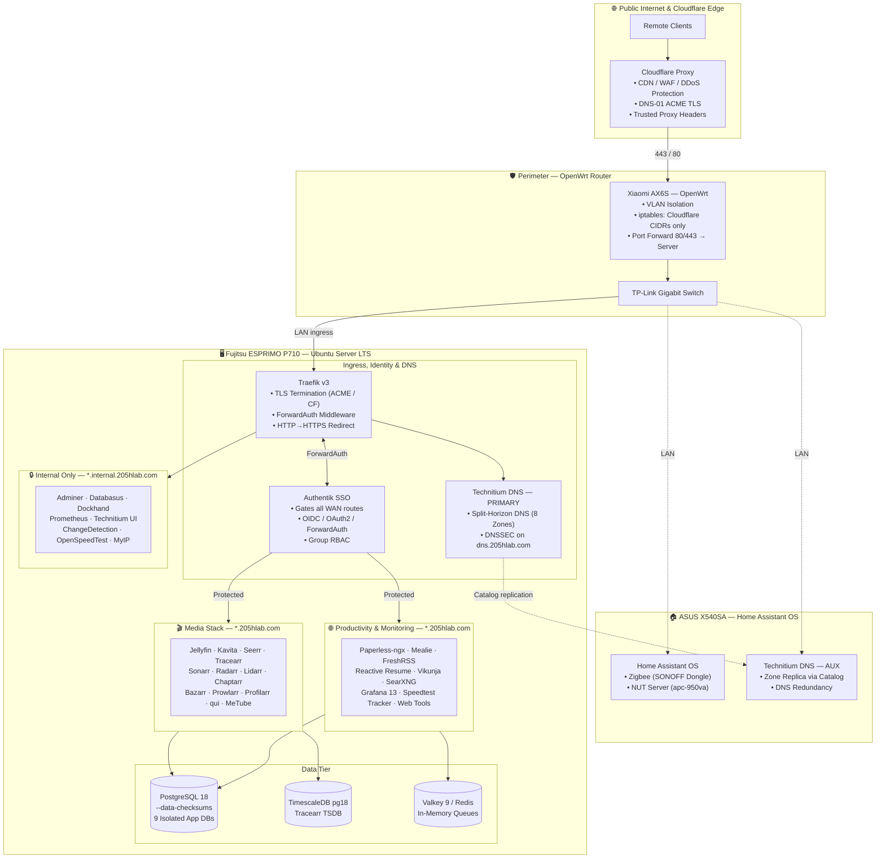
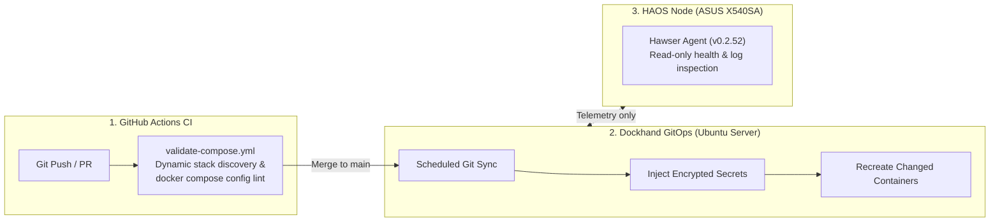

<div align="center">

# 205hlab

**Production Homelab Infrastructure & Engineering Portfolio**

[](https://github.com/Dr20Ervin/205hlab/actions/workflows/validate-compose.yml)
[](https://github.com/Dr20Ervin/205hlab/actions/workflows/security-gitleaks.yml)
[](https://github.com/Dr20Ervin/205hlab/actions/workflows/link-checker.yml)

<br/>

[](https://github.com/Dr20Ervin/205hlab/releases)
[](LICENSE)
[](https://ubuntu.com)
[](https://docs.docker.com/compose/)
[](https://traefik.io)
[](https://goauthentik.io)
[](https://www.cloudflare.com)
[](https://www.postgresql.org)
[](https://grafana.com)
[](https://prometheus.io)

<br/>

**[🖥️ Hardware](#-physical-infrastructure) · [🏗️ Architecture](#-system-architecture) · [📜 ADRs](docs/adr/README.md) · [🚨 Runbooks](docs/runbooks/README.md) · [📦 Services & DNS](#-services-routing--dns) · [🔒 Security](#-security-posture) · [🚀 Operations & Backups](#-operations-cicd--backups) · [👤 Author](#-author)**

<br/>

> *Snapshot Release `2026-11-18` — Production architecture baseline, running 24/7 at home.*

</div>

---

> [!NOTE]
> **On AI-Assisted Documentation**
> All code, configurations, and infrastructure design in this repository were **written and engineered by me**. AI tooling was used exclusively for repetitive, non-creative tasks — such as standardizing formatting across compose files, cross-checking for missing environment variables, and drafting documentation from my own notes and descriptions. Every architectural decision, service selection, security design, and line of configuration reflects my own work and understanding. This README and accompanying docs were written with AI assistance to accelerate documentation — the production infrastructure itself was not.

---

## 📌 About This Repository

This repository is both my **live home production environment** and my **systems engineering portfolio**. Everything documented here runs 24/7 in my apartment—handling DNS, identity management, document archival, task tracking, network monitoring, and media automation for my household.

Because my household relies on these services daily, I treat the setup like a real production environment rather than a sandbox. Changes go through GitHub Actions syntax and variable linting, deployments sync via GitOps, databases are backed up and automatically restore-tested every night, and major design trade-offs are recorded in [Architecture Decision Records (`docs/adr/`)](docs/adr/README.md) paired with [Operational Runbooks (`docs/runbooks/`)](docs/runbooks/README.md).

---

## 🖥️ Physical Infrastructure

### Primary Server — Fujitsu ESPRIMO P710

| Component | Specification |
| :--- | :--- |
| **System** | Fujitsu ESPRIMO P710 Tower · Ubuntu Server LTS |
| **CPU & RAM** | Intel Core i7-3770 (4C/8T, 3.2–3.6 GHz) · 32 GB DDR3 |
| **iGPU** | Intel HD Graphics 4000 (`/dev/dri` passed to Jellyfin for VAAPI transcoding) |
| **OS & App SSDs** | 240 GB Kingston A400 (OS) + 480 GB ADATA SU630 (`/srv` Docker volumes & app data) |
| **ZFS Pool (`BinPool`)** | 2× 4 TB Hitachi Enterprise HDDs (OpenZFS mirror — backups, documents & bulk media) |
| **Network** | TP-Link TG-3468 Gigabit PCIe NIC |

### HAOS / Smart Home + Auxiliary DNS — ASUS X540SA

| Component | Specification |
| :--- | :--- |
| **System** | Repurposed ASUS X540SA Laptop · Home Assistant OS (HAOS) |
| **CPU, RAM & Storage** | Intel Celeron N3060 (2C/2T) · 4 GB DDR3 · 240 GB Kingston A400 SSD |
| **USB Peripherals** | SONOFF Zigbee 3.0 Dongle Plus · APC Back-UPS XS 950U (NUT server) |
| **Role** | Smart home automation, UPS power telemetry, and **Auxiliary Technitium DNS** (`technitium-aux`) |

### Network Gear & Edge

| Component | Role |
| :--- | :--- |
| **Xiaomi Redmi Router AX6S** | Flashed with custom-compiled **OpenWrt** — VLAN isolation, firewall zones, hardware NAT, Cloudflare CIDR port-forwarding |
| **TP-Link 5-Port GbE Switch** | Wired gigabit LAN switching |
| **Cloudflare** | Edge reverse proxy, WAF, DDoS mitigation, and DNS-01 ACME certificate validation |

### Why This Hardware?

- **Apartment-Friendly Repurposed E-Waste:** Running a loud, power-hungry rack server in an apartment makes no sense financially or acoustically. Both the Fujitsu tower and ASUS laptop were rescued from discarded hardware. The i7-3770 has a low idle power draw, stays quiet, and its built-in QuickSync iGPU handles video transcoding without needing a discrete GPU.
- **Fault Isolation (Two-Node Split):** I used to run Home Assistant inside a VM on my main server, which meant every host reboot or maintenance window took down the smart lights and Zigbee network. Moving HAOS and the secondary DNS server onto the dedicated ASUS laptop (which also has its own built-in battery alongside the APC UPS) keeps smart home automation and LAN DNS resolution online even if the main Ubuntu server is powered off.
- **Production vs. Lab Separation:** This hardware strictly runs stable household services. Whenever I test new tooling—like multi-node K3s clusters, HashiCorp Vault, or Proxmox SDN setups—I spin them up in isolated VMs on separate test hardware so I don't break production.

---

## 🏗️ System Architecture



### 📜 Architecture Decision Records (ADRs) & Runbooks

Key architectural trade-offs and the alternatives I rejected are documented in [`docs/adr/`](docs/adr/README.md), each paired with a recovery procedure in [`docs/runbooks/`](docs/runbooks/README.md):

| ADR | Decision | Why I Built It This Way | Operational Runbook |
| :--- | :--- | :--- | :--- |
| **[ADR-001](docs/adr/ADR-001-centralized-postgresql-18.md)** | Centralized PostgreSQL 18 (`--data-checksums`) | Running 1 shared Postgres container instead of 9 separate DB instances saves ~2.5 GB of idle RAM on a 32 GB host and simplifies nightly backups. | [**`disaster-recovery.md`**](docs/runbooks/disaster-recovery.md) |
| **[ADR-002](docs/adr/ADR-002-authentik-unified-iam.md)** | Unified Authentik SSO & ForwardAuth | Puts a single login and RBAC layer in front of all 32 services (native OIDC where supported, Traefik ForwardAuth everywhere else). | [**`iam-and-ingress-recovery.md`**](docs/runbooks/iam-and-ingress-recovery.md) |
| **[ADR-003](docs/adr/ADR-003-split-horizon-technitium-dns.md)** | Split-Horizon Technitium DNS + Catalog HA | Keeps admin UIs (`*.internal.205hlab.com`) completely off public DNS while automatically syncing zones to the HAOS backup node. | [**`dns-failover-and-sync.md`**](docs/runbooks/dns-failover-and-sync.md) |
| **[ADR-004](docs/adr/ADR-004-dockhand-gitops-continuous-deployment.md)** | Dockhand GitOps & Runtime Secrets | Syncs compose stacks from GitHub and injects secrets from an encrypted DB at container startup so plaintext `.env` files never sit on disk. | [**`stack-upgrade-and-rollback.md`**](docs/runbooks/stack-upgrade-and-rollback.md) |
| **[ADR-005](docs/adr/ADR-005-decouple-smart-home-haos-appliance.md)** | Decoupled HAOS Appliance (ASUS X540SA) | Isolates Zigbee, UPS monitoring (NUT), and backup DNS onto low-power battery-backed hardware so server maintenance doesn't impact the house. | [**`power-outage-and-storage-health.md`**](docs/runbooks/power-outage-and-storage-health.md) |

---

## 📦 Services, Routing & DNS

### 🧭 Technitium DNS — Dual-Instance Architecture

Services are split into two routing tiers enforced by **Technitium DNS** and **Traefik v3**:

| Subdomain Pattern | Scope | Access Policy |
| :--- | :--- | :--- |
| `*.205hlab.com` | **WAN + LAN** | Routed through Cloudflare Proxy and gated by **Authentik** (native OIDC or Traefik `ForwardAuth` middleware). |
| `*.internal.205hlab.com` | **LAN Only** | Authoritative only inside the local `internal.205hlab.com` Technitium zone. These records do not exist in public Cloudflare DNS. |

To prevent LAN DNS outages when rebooting the primary Ubuntu server, **Technitium DNS** runs in an active/secondary pair. The primary instance on Ubuntu Server is authoritative for 8 zones (`205hlab.com` forwarder, `internal`, `dns` with DNSSEC, `lan`, `mngt`, reverse PTR zones for LAN and `MNGT_VLAN`, and `cluster-catalog.dns.205hlab.com`). Any zone update automatically replicates to the auxiliary Technitium instance on the HAOS appliance via RFC Catalog Zones, with `1.1.1.1` and `9.9.9.9` as upstream resolvers and network-wide ad/malware blocklists.

---

### Service Catalog (23 Compose Stacks)

> Full stack configurations, environment templates, and per-service documentation live in **[`compose/`](compose/README.md)**.

#### 🔀 Ingress, Identity, Data & Management

| Stack | Services & Role | Route | Auth / Access |
| :--- | :--- | :--- | :--- |
| [`traefik`](compose/traefik/) | **Traefik v3.7** — Reverse proxy, Cloudflare DNS-01 ACME TLS, ForwardAuth chaining, Prometheus metrics (`:9090`). | — | Edge Ingress |
| [`authentik`](compose/authentik/) | **Authentik 2026.8** — Central IdP providing OIDC, OAuth2, Traefik ForwardAuth outpost, and group RBAC. | `authentik.205hlab.com` | IdP Root |
| [`technitium`](compose/technitium/) | **Technitium DNS 15.6** — Primary split-horizon resolver, DNSSEC, Catalog sync to HAOS `technitium-aux`. | `technitium.internal.205hlab.com` | LAN-only (`:5380` mngt) |
| [`postgres`](compose/postgres/) | **PostgreSQL 18.3** (`--data-checksums`, per-app DBs provisioned via `db-init.sql`) + **Adminer** web UI. | `adminer.internal.205hlab.com` | LAN-only |
| [`databasus`](compose/databasus/) | **Databasus** + **`databasus-verifier`** — Nightly `pg_dump` backups with automated test restores into ephemeral PG18 containers. | `databasus.internal.205hlab.com` | LAN + ForwardAuth |
| — (Host) | **Dockhand** — GitOps engine on Ubuntu Server + remote **Hawser agent (v0.2.52)** observing HAOS containers. | `dockhand.internal.205hlab.com` | LAN + ForwardAuth |

#### 📊 Observability & Network Diagnostics

| Stack | Services & Role | Route | Auth / Access |
| :--- | :--- | :--- | :--- |
| [`prometheus`](compose/prometheus/) | **Prometheus v3.11** — Central TSDB (30-day retention, 50 GB cap). | `prometheus.internal.205hlab.com` | LAN-only |
| [`grafana`](compose/grafana/) | **Grafana 13.0** — Dashboards with Authentik OIDC role mapping (`Admin`, `Editor`, `Viewer`). | `grafana.205hlab.com` | OIDC |
| [`prom-exporters`](compose/prom-exporters/) | **6 Metric Exporters** — `node-exporter`, `cadvisor`, `postgres`, `technitium`, `zfs`, `smartctl` (+ OpenWrt & NUT scrapes). | Internal scrape network | Internal |
| [`network-mon`](compose/network-mon/) | **Speedtest Tracker** (3-hour WAN tests on PG18), **OpenSpeedTest** (LAN throughput on `:3000`), and **MyIP** (leak diagnostics on `:18966`). | `speedtest.205hlab.com`<br>`openspeed.internal.205hlab.com`<br>`myip.internal.205hlab.com` | ForwardAuth<br>LAN-only<br>LAN + ForwardAuth |
| [`uptime-kuma`](compose/uptime-kuma/) | **Uptime Kuma v2** + **MariaDB 11.6** — Blackbox service sentinel, container healthchecks, and public status page. Probed out-of-band by HAOS watchdog. | `uptime.205hlab.com`<br>`status.205hlab.com` | ForwardAuth<br>Public (No Auth) |

<details>
<summary><strong>📈 Version-Controlled Grafana Dashboards (<code>grafana-dashboards/</code>)</strong></summary>
<br/>

11 declarative JSON dashboards are stored in [`grafana-dashboards/`](grafana-dashboards/README.md) across three folders:
- **`205hlab - Core`:** `authentik` · `PostgreSQL Database` · `Speedtest Tracker` · `Technitium DNS Exporter` · `Traefik Standalone Dashboard` · `cAdvisor`
- **`205hlab - Hardware`:** `APC UPS Dashboard` · `Node Exporter Full` · `OpenWRT` · `ZFS / Overview`
- **`205hlab - SaaS`:** `Qui overview`

</details>

#### 🏠 Household SaaS & Utilities

| Stack | Services & Engineering Notes | Route | Auth |
| :--- | :--- | :--- | :--- |
| [`paperless`](compose/paperless/) | **Paperless-ngx** + **Gotenberg 8** + **Apache Tika** + **Valkey 9** — OCR document archive stored on `BinPool`. | `paperless.205hlab.com` | OIDC |
| [`mealie`](compose/mealie/) | **Mealie** — Household recipe manager and meal planner backed by PostgreSQL 18. | `mealie.205hlab.com` | OIDC |
| [`freshrss`](compose/freshrss/) | **FreshRSS 1.30** — News reader + **Release Sentinel** tracking GitHub releases for all 22 stacks via versioned OPML ([`rss-feeds/`](compose/freshrss/rss-feeds/)). | `freshrss.205hlab.com` | OIDC |
| [`reactive-resume`](compose/reactive-resume/) | **Reactive Resume v6** + **Valkey 9** — Self-hosted CV builder backed by PostgreSQL 18. | `resume.205hlab.com` | OIDC |
| [`vikunja`](compose/vikunja/) | **Vikunja** — Task manager & recurring homelab maintenance reminders (CalDAV sync, PG18 backend). | `vikunja.205hlab.com` | OIDC |
| [`searxng`](compose/searxng/) | **SearXNG** + **Gluetun (WireGuard/AirVPN)** + **Valkey 9** — Privacy metasearch routing outbound queries over VPN to avoid ISP rate limits. | `search.205hlab.com` | ForwardAuth |
| [`changedetection`](compose/changedetection/) | **ChangeDetection.io** + **SockpuppetBrowser** (Playwright Chrome) — Web page change & price monitor. | `changedetection.internal.205hlab.com` | LAN-only |
| [`web-tools`](compose/web-tools/) | **IT-Tools**, **Omni-Tools**, **Draw.io**, **BentoPDF** — Client-side browser/WASM utilities running on read-only root filesystems. | `it-tools` · `omni` · `draw` · `pdf`<br>`(.205hlab.com)` | ForwardAuth |

#### 🎬 Media Automation & Delivery

| Stack | Services & Engineering Notes | Route | Auth |
| :--- | :--- | :--- | :--- |
| [`jelly`](compose/jelly/) | **Jellyfin** (Intel HD 4000 `/dev/dri` VAAPI hardware transcoding) + **Seerr** media request portal. | `jellyfin.205hlab.com`<br>`seer.205hlab.com` | OIDC (Plugin)<br>ForwardAuth |
| [`kavita`](compose/kavita/) | **Kavita** — Digital reader for eBooks, manga, and comics mounted read-only from `BinPool`. | `kavita.205hlab.com` | OIDC |
| [`servarr`](compose/servarr/) | **Sonarr** (TV) · **Radarr** (Movies) · **Lidarr** (Music) · **Chaptarr** (Books/Audiobooks) · **Bazarr** (Subtitles) · **Prowlarr** (Indexers) · **Profilarr** (Quality profiles) · **FlareSolverr**. Migrated to PostgreSQL 18. | `sonarr` · `radarr` · `lidarr`<br>`chaptarr` · `bazarr` · `prowlarr`<br>`profilarr` `(.205hlab.com)` | ForwardAuth<br>(Profilarr: OIDC) |
| [`downloaderr`](compose/downloaderr/) | **qBittorrent** bound inside **Gluetun WireGuard VPN** (`network_mode: service:gluetun` with kill-switch) + **qui** web UI + **MeTube** downloader. | `qui.205hlab.com`<br>`metube.205hlab.com` | OIDC<br>ForwardAuth |
| [`tracearr`](compose/tracearr/) | **Tracearr** + **TimescaleDB (PG18)** + **Redis 8** — Playback analytics and streaming telemetry. | `tracearr.205hlab.com` | ForwardAuth |

---

## 🔒 Security Posture

Security is handled in layers from the Cloudflare edge down to individual container definitions:

```text
[ Cloudflare Edge WAF & DDoS Protection ]
                   ↓
[ OpenWrt Firewall: Allows only Cloudflare IPs & LAN CIDRs on 80/443 ]
                   ↓
[ Traefik v3: DNS-01 ACME TLS + Security Headers + ForwardAuth ]
                   ↓
[ Authentik SSO: OIDC or ForwardAuth required on every WAN route ]
                   ↓
[ Scoped Docker Bridge Networks + Hardened Containers + Runtime Secrets ]
```

| Layer | Implementation |
| :--- | :--- |
| **Perimeter Firewall** | OpenWrt `iptables` and Ubuntu host rules drop all inbound WAN packets unless they originate from official **Cloudflare IP ranges**. Direct-to-IP scans on ports 80/443 are silently dropped. |
| **Zero-Port-80 TLS** | Traefik obtains wildcard certificates via Let's Encrypt **DNS-01 ACME** (Cloudflare API token), avoiding HTTP-01 port 80 exposure. |
| **Mandatory WAN SSO** | Every `*.205hlab.com` route requires **Authentik** authentication—either via native OIDC with JWT entitlement claims or Traefik's `authentik@docker` ForwardAuth middleware. |
| **Network Microsegmentation** | Stacks communicate over scoped bridge networks (`traefik_network`, `postgres_network`, `monitoring_network`, `servarr_backend`). Database ports are never published to the host. |
| **Container Hardening** | Containers run with `no-new-privileges:true`, non-root `PUID`/`PGID` mappings, read-only Docker sockets (`:ro`), and explicit CPU/RAM limits (`deploy.resources.limits`) so a runaway process cannot starve the host. |
| **No Plaintext `.env` Files** | Production credentials live encrypted inside **Dockhand's** database and are injected into container memory at deploy time. No production `.env` files sit on the host SSD, and repository `example.env` files use strict `${VAR:?error}` validation guards with dummy placeholders. |

---

## 📁 Repository Structure

```text
205hlab/
├── .github/
│   ├── scripts/prepare-test-env.py       # Populates dummy env vars for CI linting
│   ├── workflows/validate-compose.yml    # GitHub Actions CI: validates all compose stacks
│   └── ISSUE_TEMPLATE/ & PR_TEMPLATE     # Repository contribution templates
├── assets/                               # Custom SVG/PNG icons & branding for Authentik/dashboards
├── compose/                              # 23 Docker Compose stacks (compose.yaml, example.env, db-init.sql)
├── docs/
│   ├── adr/                              # Architecture Decision Records (ADR-001 .. ADR-005)
│   └── runbooks/                         # Disaster recovery & operational SOPs
├── grafana-dashboards/                   # 11 versioned JSON dashboards (core, hardware, saas)
└── README.md
```

---

## 🚀 Operations, CI/CD & Backups

### 🔄 Production CI/CD Pipeline (GitHub Actions & Dockhand GitOps)



1. **Continuous Integration ([`validate-compose.yml`](.github/workflows/validate-compose.yml)):** On every push or PR touching `compose/**`, GitHub Actions discovers all stack folders, generates mock environment variables from each stack's `example.env`, and runs `docker compose config --quiet` to catch YAML syntax errors or missing variable references before merge.
2. **GitOps Deployment (Dockhand):** Dockhand on the primary Ubuntu server polls `main`, injects encrypted credentials from its internal vault, and updates modified stacks. The auxiliary HAOS laptop is linked via a **Hawser agent** strictly for container status/log monitoring (HAOS manages its own add-on lifecycle natively).

<a id="-manual-cli-deployment-fallback--disaster-recovery"></a>
<a id="recommended-stack-startup-order"></a>
<details>
<summary><strong>🛠️ Manual CLI Bootstrap & Startup Order (Disaster Recovery Fallback)</strong></summary>
<br/>

If bootstrapping from a fresh Ubuntu Server install without Dockhand:

```bash
# 1. Create shared external Docker networks
for net in traefik_network postgres_network monitoring_network servarr_backend; do
  docker network create "$net"
done

# 2. Configure and start a stack
cd /opt/205hlab/compose/<stack-name>
cp example.env .env && bash setup_secrets.sh
nano .env && docker compose up -d
```

**Dependency Startup Sequence:**
1. `traefik` → 2. `postgres` → 3. `databasus` → 4. `authentik` → 5. `technitium` → 6. `prometheus` & `prom-exporters` → 7. `grafana` → 8. Application & Media stacks (`paperless`, `mealie`, `freshrss`, `reactive-resume`, `vikunja`, `changedetection`, `searxng`, `jelly`, `kavita`, `servarr`, `downloaderr`, `tracearr`, `network-mon`, `web-tools`).

</details>

---

### 💾 Backup Strategy & Power Resilience

> Step-by-step restore commands and RPO/RTO targets are maintained in [**`docs/runbooks/disaster-recovery.md`**](docs/runbooks/disaster-recovery.md) and [**`power-outage-and-storage-health.md`**](docs/runbooks/power-outage-and-storage-health.md).

- **Automated Database Backups & Restore Verification (`24h RPO`):** **Databasus** runs nightly `pg_dump` jobs for all databases on PostgreSQL 18 and writes them to the mirrored OpenZFS pool (`BinPool`). Immediately after each dump, the **`databasus-verifier`** agent spins up a temporary PostgreSQL 18 container, restores the backup, and verifies table schemas and row counts so broken backups are caught immediately.
- **Appliance & Config Exports:** OpenWrt `.tar.gz` configs, HAOS `.tar` snapshots, Technitium `.zip` zone archives, Dockhand vault state, and Paperless document folders on `BinPool` are replicated to secondary offline storage devices.
- **UPS Graceful Shutdown (NUT):** The **APC Back-UPS XS 950U** is monitored by the NUT server on the ASUS X540SA laptop. If battery charge drops below 65% (or runtime below 5 minutes) during a blackout, the Ubuntu Server NUT client cleanly stops Docker containers, checkpoints PostgreSQL, and exports `BinPool` before power loss, while the laptop's internal battery keeps HAOS and secondary DNS alive.
- **Roadmap to Full 3-2-1 Backups:** Currently in an intermediate state (local ZFS mirror + manual offline copies + in-progress cloud sync). The next storage milestone is expanding the OpenZFS pool with automated `zstd` snapshot retention (`zfs-auto-snapshot`) and scheduled encrypted Restic/Rclone replication to immutable cloud object storage (Backblaze B2 / Cloudflare R2).

---

## 👤 Author

<div align="center">

**Vajda Ervin-Olivér**  
*Aspiring DevOps & Infrastructure Engineer · Telecommunications Engineering Student @ UTCN*

[](https://github.com/Dr20Ervin)
[](https://www.linkedin.com/in/ervin-vajda-970436152)
[](mailto:dr20ervin@outlook.com)

<br>

*Undergraduate ETTI student at the Technical University of Cluj-Napoca specializing in Communications. Focused on designing, deploying, and managing on-premises infrastructure.*

**Core Competencies:** Bare-Metal Administration (Ubuntu, ZFS) • Container Orchestration (Docker Compose) • Edge Routing & Security (Traefik, Cloudflare) • Identity Management (Authentik) • Network Architecture (OpenWrt, WireGuard)

</div>

<br>

### 🎓 About Me

I am an undergraduate engineering student at the **Technical University of Cluj-Napoca (UTCN)** in the Faculty of Electronics, Telecommunications and Information Technology (**ETTI**), specializing in **Communications**. My coursework covers physical-layer communications, signal processing, networking protocols, and telecommunications systems.

Outside of university, I spend my time building and operating **real Linux, networking, and container infrastructure**. For me, running a 24/7 production homelab is the best way to bridge academic theory with hands-on systems engineering—dealing with real constraints like RAM budgeting, silent disk corruption, DNS failover, TLS lifecycle automation, and disaster recovery drills.

### 🧠 My Homelab Evolution (3–4 Years of Iteration)

While `205hlab` represents my current bare-metal Ubuntu Server baseline, it is the result of 3–4 years of building, breaking, and iterating through different stacks in my homelab and virtualized test environments (documented in detail across [`docs/adr/`](docs/adr/README.md)):

- **Virtualization & Hypervisors (`Proxmox VE` & `PBS`):** Built and operated **Proxmox VE** clusters—working with KVM virtual machines, unprivileged LXC containers, PCIe/GPU passthrough, Software-Defined Networking (SDN with VLANs and VNet overlays), HA cluster fencing, live migration, and automated backups via **Proxmox Backup Server (PBS)**.
- **Enterprise Storage (`TrueNAS` & `OpenZFS`):** Designed and managed ZFS storage pools on **TrueNAS (Core & SCALE)** and Linux—testing RAID-Z1/Z2/Z3 and mirrored vdev topologies, tuning dataset `recordsize` per workload, configuring L2ARC/ZIL SSD caching, setting up SSH snapshot replication, and running scheduled bit-rot scrubs.
- **OS & Container Orchestration (`CLI` → `Portainer` → `Dockge & Unraid` → `Ubuntu + Dockhand`):** Progressed from raw Docker CLI to **Portainer**, and then to **Dockge on Unraid** (monitored alongside **Beszel**). While Unraid was convenient as a consumer NAS, it abstracted away too much of the underlying OS—limiting direct control over `systemd`, raw OpenZFS, kernel tuning, and `iptables`. I moved back to **bare-metal Ubuntu Server LTS** paired with **Dockhand GitOps** and encrypted deploy-time secret injection ([ADR-004](docs/adr/ADR-004-dockhand-gitops-continuous-deployment.md)).
- **Databases (`SQLite / phpMyAdmin / pgAdmin` → `Centralized PostgreSQL 18`):** Earlier lab generations mixed default **SQLite** files with scattered SQL/PostgreSQL instances managed first through **phpMyAdmin** and later via a desktop **pgAdmin** client on my laptop. Consolidating onto a single **PostgreSQL 18** (`--data-checksums`) cluster solved SQLite concurrency lock errors, saved gigabytes of idle RAM, enabled browser-based inspection via **Adminer**, and unified nightly backups and restore verification under **Databasus** ([ADR-001](docs/adr/ADR-001-centralized-postgresql-18.md)).
- **Directory Services & IAM (`Windows AD DS` → `OpenLDAP` → `FreeIPA` → `Authentik`):** Started with **Windows Server Active Directory (AD DS)** in a VM (GPO, Kerberos, DNS, DHCP), migrated to **OpenLDAP**, and then adopted Red Hat **FreeIPA** to govern centralized POSIX UID/GID permissions across **OpenZFS datasets and NFS shares** (intentionally omitted from this single-node bare-metal host, and ready to re-deploy when scaling to a multi-node cluster). For web apps, I moved from selective SSO to 100% mandatory **Authentik** OIDC and Traefik ForwardAuth across every service ([ADR-002](docs/adr/ADR-002-authentik-unified-iam.md)).
- **Ingress & Perimeter (`NPM + Cloudflared` → `Cloudflared Only` → `Traefik v3 + WAF + iptables`):** Early labs combined **Nginx Proxy Manager (NPM)** with **Cloudflare Tunnels (`cloudflared`)**, then used Cloudflare Tunnels exclusively. For `205hlab`, I retired tunnels in favor of **Traefik Proxy v3** (DNS-01 ACME TLS, dynamic providers, middleware chaining) behind **Cloudflare Proxy/WAF** and strict OpenWrt/Ubuntu **`iptables` Cloudflare origin IP allowlisting** ([ADR-002](docs/adr/ADR-002-authentik-unified-iam.md)).
- **DNS Progression (`Pi-hole` → `AdGuard Home` → `ISC BIND9` → `Technitium DNS`):** Iterated through four DNS setups: **Pi-hole** (with external multi-node sync scripts), **AdGuard Home** (with sync), raw **ISC BIND9** (authoritative text zonefiles and AXFR transfers), and finally dual-node **Technitium DNS**—combining BIND9-style authoritative zones, DNSSEC, and native **RFC Catalog Zone** automatic replication with built-in ad/malware blocklists and an OIDC web UI ([ADR-003](docs/adr/ADR-003-split-horizon-technitium-dns.md)).
- **Observability (`InfluxDB + Telegraf` / `Uptime Kuma` / `Loki & Alloy` → `Prometheus + Grafana`):** Built monitoring stacks with **InfluxDB + Telegraf**, **Uptime Kuma**, **Grafana Loki**, and **Grafana Alloy** (evaluated and deferred until multi-node expansion), currently standardized on **Prometheus v3** and **Grafana 13**.
- **Smart Home Fault Isolation (`Main-Server VM` → `Dedicated HAOS Appliance`):** After running Home Assistant inside a **VM on my main server** for years—where every host reboot or maintenance window took down apartment lighting and Zigbee sensors—I moved **Home Assistant OS (HAOS)**, the **NUT UPS server**, and the **auxiliary Technitium DNS replica** onto the dedicated, battery-backed **ASUS X540SA** appliance ([ADR-005](docs/adr/ADR-005-decouple-smart-home-haos-appliance.md)).
- **Current Staging / R&D Lab:** In isolated VMs on separate test hardware, I actively experiment with **Kubernetes (K3s)**, **ArgoCD**, **HashiCorp Vault**, **Terraform**, and **Ansible**.

### 🛠️ Technical Toolkit

| Area | Tools & Technologies |
| :--- | :--- |
| **Linux & Storage** | Ubuntu Server LTS, Debian, OpenZFS, TrueNAS Core/SCALE, systemd, Bash scripting, S.M.A.R.T. & UPS (NUT) monitoring |
| **Containers & CI/CD** | Docker, Docker Compose v2, GitHub Actions, Dockhand GitOps, Kubernetes (K3s in staging), Terraform & Ansible (learning/lab) |
| **Networking & Security** | OpenWrt, VLANs, `iptables`/`nftables`, WireGuard (Gluetun), Traefik v3, Cloudflare (WAF, CDN, DNS-01 ACME), Technitium DNS, BIND9 |
| **Identity & Databases** | Authentik (OIDC/OAuth2/ForwardAuth), FreeIPA, Active Directory, PostgreSQL 18, TimescaleDB, Valkey / Redis, Databasus |
| **Observability & Virtualization** | Prometheus, Grafana, Node/cAdvisor/ZFS/PG Exporters, Grafana Loki, Proxmox VE (KVM, LXC, PBS) |

### 🎯 Looking for Opportunities

I am actively looking for **Internships or Junior roles** in **DevOps, Infrastructure Engineering, Systems Administration, or Network/Cloud Engineering**. If you need someone who enjoys digging into how networks, Linux hosts, and containers work under the hood—feel free to reach out!

<div align="center">

[](https://www.linkedin.com/in/ervin-vajda-970436152)
[](mailto:dr20ervin@outlook.com)

<br>

**License:** [MIT](LICENSE) · © 2026 [Vajda Ervin-Olivér](https://github.com/Dr20Ervin)  
*If you found this repository useful or interesting, consider giving it a ⭐!*

</div>
