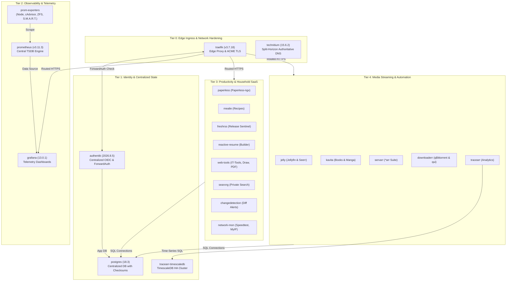

# Docker Compose Stacks — Production Homelab Orchestration

[](https://docs.docker.com/compose/)
[](https://github.com/Dr20Ervin/205hlab/tree/main/compose)
[](#-network-topology--microsegmentation)
[](#-production-engineering-standards)
[](postgres/)

This directory houses the **20 production Docker Compose stacks** powering the `205hlab` bare-metal infrastructure. Every stack is engineered as an autonomous, self-contained unit adhering to uniform DevOps standards: strict cgroup resource constraints, standardized healthchecks, isolated bridge networks, centralized persistence, and zero-trust edge authentication.

---

## 📑 Master Stack Catalog

| Stack | Category | Primary Ingress URL | Auth Model | Data & Persistence | Dedicated Runbook |
| :--- | :--- | :--- | :--- | :--- | :--- |
| **[`authentik`](authentik/)** | IAM & Security | `https://authentik.205hlab.com` | **IdP Core** | PostgreSQL 18, Valkey 9 Cache | [Runbook](authentik/README.md) |
| **[`traefik`](traefik/)** | Edge Routing & TLS | `https://*.205hlab.com` | **Edge Middleware** | Let's Encrypt DNS-01 (`acme.json`) | [Runbook](traefik/README.md) |
| **[`technitium`](technitium/)** | DNS & Ad-Blocking | `https://technitium.internal.205hlab.com` | Method 1 (Native OIDC) | Authoritative Zones, Catalog Sync | [Runbook](technitium/README.md) |
| **[`postgres`](postgres/)** | Relational Data Tier | `https://adminer.internal.205hlab.com` | Method 2 (ForwardAuth) | PostgreSQL 18 (`--data-checksums`) | [Runbook](postgres/README.md) |
| **[`prometheus`](prometheus/)** | Metrics TSDB | `https://prometheus.internal.205hlab.com` | Internal LAN Only | 30d TSDB Retention (50 GB cap) | [Runbook](prometheus/README.md) |
| **[`prom-exporters`](prom-exporters/)** | Telemetry Scrapers | *(Internal Scrape Targets)* | Internal Scrape Network | Host `/proc`, `/sys`, `/dev/zfs`, S.M.A.R.T. | [Runbook](prom-exporters/README.md) |
| **[`grafana`](grafana/)** | Observability UI | `https://grafana.205hlab.com` | Method 1 (Native OIDC) | Provisioned Dashboards, SQLite | [Runbook](grafana/README.md) |
| **[`paperless`](paperless/)** | Document OCR Archive | `https://paperless.205hlab.com` | Method 1 (Native OIDC) | PostgreSQL 18, Valkey 9, Tika, Gotenberg | [Runbook](paperless/README.md) |
| **[`mealie`](mealie/)** | Recipe & Meal Planner | `https://mealie.205hlab.com` | Method 1 (Native OIDC) | PostgreSQL 18, Named Volume | [Runbook](mealie/README.md) |
| **[`freshrss`](freshrss/)** | Release Sentinel / RSS | `https://freshrss.205hlab.com` | Method 1 (Native OIDC) | PostgreSQL 18, Dynamic OPML Feeds | [Runbook](freshrss/README.md) |
| **[`reactive-resume`](reactive-resume/)** | Career Builder | `https://resume.205hlab.com` | Method 1 (Native OIDC) | PostgreSQL 18, Valkey 9 Queue | [Runbook](reactive-resume/README.md) |
| **[`jelly`](jelly/)** | Media Streaming & Seerr | `https://jellyfin.205hlab.com` | Method 1 (SSO) / Method 2 | Intel HD 4000 VAAPI, ZFS Media Pools | [Runbook](jelly/README.md) |
| **[`kavita`](kavita/)** | Digital Reading Library | `https://kavita.205hlab.com` | Method 1 (Native OIDC) | Read-only Book/Manga ZFS Mounts | [Runbook](kavita/README.md) |
| **[`servarr`](servarr/)** | Media Automation Suite | `https://*.205hlab.com` (sonarr, radarr...) | Method 1 (Profilarr) / Method 2 | PostgreSQL 18 (`*-main`), SQLite | [Runbook](servarr/README.md) |
| **[`downloaderr`](downloaderr/)** | Acquisition Engine | `https://qui.205hlab.com`, `metube...` | Method 1 (qui) / Method 2 | PostgreSQL 18, AirVPN WireGuard | [Runbook](downloaderr/README.md) |
| **[`tracearr`](tracearr/)** | Stream Analytics | `https://tracearr.205hlab.com` | Method 2 (ForwardAuth) | TimescaleDB Hypertables, Redis 8 | [Runbook](tracearr/README.md) |
| **[`searxng`](searxng/)** | Private Metasearch | `https://search.205hlab.com` | Method 2 (ForwardAuth) | Valkey 9 Cache, AirVPN WireGuard | [Runbook](searxng/README.md) |
| **[`network-mon`](network-mon/)** | Network Diagnostics | `https://speedtest.205hlab.com` | Method 2 (ForwardAuth) / LAN | PostgreSQL 18, Host Port Binds | [Runbook](network-mon/README.md) |
| **[`changedetection`](changedetection/)** | Web Diff & Alerting | `https://changedetection.internal...` | Method 2 (ForwardAuth) | Playwright Stealth Chrome Engine | [Runbook](changedetection/README.md) |
| **[`web-tools`](web-tools/)** | Client-Side WASM Utilities | `https://it-tools.205hlab.com` (omni, draw, pdf) | Method 2 (ForwardAuth) | Stateless (`read_only: true` Rootfs) | [Runbook](web-tools/README.md) |

---

## 🏗️ Cross-Stack Architecture & Dependency Graph

The stacks operate in a layered topology where foundational services (Ingress, DNS, IAM, and Databases) provision shared capabilities to application workloads:



---

## 🔒 Two-Tier Authentication Strategy

Every container in this repository follows a strict access hierarchy defined in [`compose/authentik/`](authentik/README.md):

```
                                  Incoming Ingress Request
                                              │
                     ┌────────────────────────┴────────────────────────┐
                     │                                                 │
            Application supports                              Application lacks
            Native OIDC / OAuth2                              Native OIDC support
                     │                                                 │
                     ▼                                                 ▼
      ┌─────────────────────────────┐                   ┌─────────────────────────────┐
      │   METHOD 1: Native OIDC     │                   │   METHOD 2: ForwardAuth     │
      │                             │                   │                             │
      │ • Client ID & Client Secret │                   │ • Traefik Edge Interception │
      │ • PKCE Verification         │                   │ • authentik@docker Header   │
      │ • In-App User Provisioning  │                   │ • Zero Unauth Packet Reach  │
      │ • Role/Group Entitlements   │                   │ • Instant Session Timeout   │
      └─────────────────────────────┘                   └─────────────────────────────┘
```

1. **Method 1: Native OpenID Connect (OIDC)**  
   Preferred for applications with built-in OAuth2 support (e.g. Mealie, Paperless-ngx, FreshRSS, Grafana, Kavita, Reactive Resume, Technitium, and Jellyfin SSO). The application receives standardized claims (`email`, `groups`, `preferred_username`) and handles user profiles and role mapping internally.

2. **Method 2: Traefik ForwardAuth (Proxy Provider)**  
   Enforced at the reverse proxy layer for applications without native OIDC (e.g. Sonarr, Radarr, Prowlarr, Bazarr, Chaptarr, Adminer, MeTube, BentoPDF, IT-Tools, SearXNG, and Speedtest Tracker). The request is intercepted by Traefik and redirected to Authentik for verification before any packets reach the upstream container.

---

## 🌐 Network Topology & Microsegmentation

Containers never share a single flat Docker bridge network. Instead, external bridge networks segregate distinct architectural responsibilities:

| Network Name | Driver | External | Purpose & Connected Workloads |
| :--- | :--- | :--- | :--- |
| **`traefik_network`** | `bridge` | `true` | Ingress gateway. Connects Traefik to all HTTP-serving containers. Direct inter-container communication across apps is blocked. |
| **`postgres_network`** | `bridge` | `true` | Isolated database tier. Connects central PostgreSQL 18 and Adminer only to database consumers (Authentik, Mealie, Paperless, FreshRSS, Servarr, qui, Reactive Resume, Speedtest). Port 5432 is never exposed to the host LAN. |
| **`monitoring_network`**| `bridge` | `true` | Telemetry bus. Dedicated for Prometheus scraping of cAdvisor, Node Exporter, PostgreSQL Exporter, Technitium Exporter, and Traefik metrics. |
| **`servarr_backend`** | `bridge` | `true` | Automation pipeline. Interconnects Sonarr, Radarr, Lidarr, Prowlarr, Seerr, Bazarr, and the download clients (qBittorrent, qui). |
| **Stack-Internal** | `bridge` | `false` | Private subnets declared within individual stacks (e.g., `paperless_internal`, `tracearr_internal`, `searxng_internal`) for local worker-to-broker queues. |

---

## 🛡️ Production Engineering Standards

All 20 compose stacks enforce standardized operational rules:

1. **Strict Resource Constraints**:  
   Every container defines explicit cgroup limits preventing rogue processes or memory leaks from destabilizing the host:
   ```yaml
   deploy:
     resources:
       limits:
         cpus: '1.0'
         memory: 1G
   ```
2. **Automated Healthchecks**:  
   Every service defines a native `healthcheck` testing application viability (`interval: 30s-60s`, `retries: 3-5`), enabling automated restart policies upon deadlock.
3. **Log Rotation Caps**:  
   Docker daemon and container definitions enforce log rollover (`max-size: 10m`, `max-file: 3`) to prevent host storage exhaustion during high-volume debug cycles.
4. **Principle of Least Privilege**:  
   Services run with `security_opt: no-new-privileges:true`. Rootless container execution and read-only mounts (`:ro`) are enforced wherever possible (e.g., in Web Tools, Tika, Gotenberg, and media consumers).
5. **Standardized Environment & Secrets Workflow**:  
   Every stack folder contains:
   - `compose.yaml`: Version-controlled service definitions using strict variable parameterization (`${VARIABLE:?error_message}`).
   - `example.env`: Fully documented environment template.
   - `setup_secrets.sh`: Executable script for generating cryptographically secure passwords and tokens via `openssl rand -hex`.
   - `.env`: Local, Git-ignored production environment file.

---

## 🚀 Standard Operating Procedures (SOP)

### 1. Bootstrapping a New Stack

```bash
cd compose/<stack-name>

# 1. Create environment configuration from template
cp example.env .env

# 2. Generate cryptographically strong secrets
chmod +x setup_secrets.sh && ./setup_secrets.sh

# 3. Adjust site-specific variables (FQDN, OIDC IDs, etc.)
nano .env

# 4. If the stack uses PostgreSQL, execute its db-init.sql against the database
docker exec -i postgres psql -U postgres < db-init.sql

# 5. Launch stack in background mode
docker compose up -d

# 6. Verify healthcheck status and live logs
docker compose ps
docker compose logs -f
```

### 2. Upgrading a Stack Safely

```bash
cd compose/<stack-name>

# 1. Pull the latest image specified in compose.yaml
docker compose pull

# 2. Recreate containers with zero downtime when possible
docker compose up -d --remove-orphans

# 3. Clean up dangling images to conserve SSD storage
docker image prune -f
```

### 3. Graceful Stack Teardown

```bash
# Stop containers while preserving all data volumes
docker compose down

# Stop and remove internal networks (volumes remain untouched)
docker compose down --remove-orphans
```
