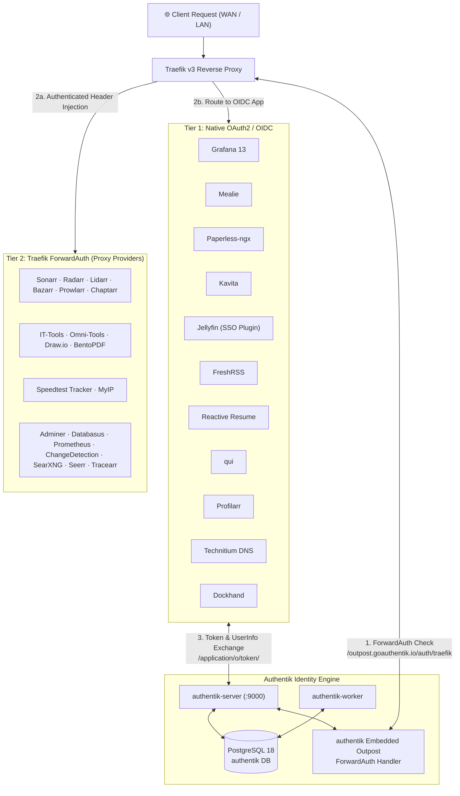

# Authentik — Identity & Access Management (IAM) Hub

[](https://goauthentik.io)
[](https://goauthentik.io/docs/architecture/)
[](https://goauthentik.io/docs/providers/proxy/)
[](https://www.postgresql.org)

> **Identity & Access Management (IAM) Hub** for the `205hlab` production homelab.  
> Authentik acts as the centralized single sign-on (SSO), OAuth2/OIDC identity provider (IdP), and Traefik ForwardAuth security perimeter for **all 31 homelab services**.

---

## 📌 Architectural Overview

Every service exposed in `205hlab` is strictly gated behind Authentik. The architecture employs a **two-tier authentication strategy**:



1. **Tier 1 — Native OAuth2 / OIDC (11 Services)**: For applications with built-in SSO capabilities (e.g. Mealie, Grafana, Paperless-ngx, Kavita, Jellyfin). The user authenticates against Authentik directly via OIDC flows, and permissions are mapped using tokens, scopes, and group claims.
2. **Tier 2 — Traefik ForwardAuth / Proxy Providers (20 Services)**: For applications without native OIDC or where uniform pre-authentication is required (e.g. Sonarr, Radarr, IT-Tools, Adminer). Traefik intercepts incoming HTTP/S requests and checks session validity with Authentik's embedded outpost before proxying the request to the upstream container.

---

## 🛡️ Traefik ForwardAuth Middleware Configuration

The core ForwardAuth middleware is declared directly in `compose/authentik/compose.yaml` and attached to Traefik routers across all compose stacks:

```yaml
labels:
  - "traefik.enable=true"
  - "traefik.docker.network=traefik_network"
  - "traefik.http.services.authentik_web.loadBalancer.server.port=9000"
  
  # ForwardAuth Middleware Definition
  - "traefik.http.middlewares.authentik.forwardauth.address=http://authentik-server:9000/outpost.goauthentik.io/auth/traefik"
  - "traefik.http.middlewares.authentik.forwardauth.trustForwardHeader=true"
  - "traefik.http.middlewares.authentik.forwardauth.authResponseHeaders=X-authentik-username,X-authentik-groups,X-authentik-entitlements,X-authentik-email,X-authentik-name,X-authentik-uid,X-authentik-jwt,X-authentik-meta-jwks,X-authentik-meta-outpost,X-authentik-meta-provider,X-authentik-meta-app,X-authentik-meta-version"
```

### Applying ForwardAuth to Any Upstream Stack
To protect any upstream service (e.g., `sonarr`, `radarr`, `speedtest`), add this single label to its Traefik router in `compose.yaml`:
```yaml
labels:
  - "traefik.http.routers.<service>_https.middlewares=authentik@docker"
```

---

## 👥 Authentik Group & RBAC Taxonomy

Access to applications, administrative privileges, and internal role mappings are governed strictly by Authentik Groups:

| Domain | Group Name | Description & In-App Role Mapping |
| :--- | :--- | :--- |
| **IAM Core** | `authentik Admins` | Full administrative control over Authentik server, flows, outposts, and policies |
| | `authentik Agent-Users` | System integration accounts & automated agent service principals |
| | `authentik Read-only` | Read-only auditor access to Authentik administration |
| **Databases & Ops** | `pgdb_admins` | Access to central PostgreSQL administration tools (Adminer, Databasus) |
| | `dockhand_admins` | Administrator access to Dockhand Docker container management UI |
| | `technitium_admins` | Full administrator rights on primary and auxiliary Technitium DNS servers |
| | `technitium_dns-admins` | DNS record management & zone editing rights on Technitium |
| **Observability** | `grafana_admins` | Mapped to Grafana **Admin** role via `entitlements` claim |
| | `grafana_editors` | Mapped to Grafana **Editor** role (create/edit dashboards and alert rules) |
| | `grafana_viewers` | Mapped to Grafana **Viewer** role (read-only telemetry viewing) |
| **Household SaaS** | `mealie_admins` | Mapped to Mealie **Admin** role (system settings, recipe management, household control) |
| | `mealie_users` | Mapped to Mealie **User** role (view recipes, generate shopping lists, log meals) |
| | `paperless_admins` | Document management administrator (system settings, global tags, users) |
| | `paperless_users` | Standard document viewing, tagging, and archiving permissions |
| | `freshrss_users` | Access to personal RSS feed reader & subscription dashboard |
| | `reactive-resume_users` | Access to Reactive Resume builder, resume creation, and PDF export |
| **Media & Library** | `jellyfin-admins` | Jellyfin media server administrator (libraries, hardware transcoding, plugins) |
| | `jellyfin-users` | Standard streaming access for household members |
| | `jellyfin-kids` | Curated children's profile access with rating restrictions |
| | `jellyfin-users-hun` | Hungarian-localized library access profile |
| | `kavita_users` | Access to Kavita digital book, comic, and manga libraries |
| | `servarr_users` | Access to media automation suite (Sonarr, Radarr, Lidarr, Bazarr, Chaptarr, Prowlarr) |
| | `qui_users` | Access to qui (qBittorrent WebUI) download manager |
| | `metube_users` | Access to MeTube video/audio downloader |
| **Utilities & Net** | `it-tools_users` | Access to developer & sysadmin client-side utilities |
| | `web-tools_users` | Access to Web Tools suite (Omni-Tools, Draw.io, BentoPDF) |
| | `searxng_users` | Access to SearXNG private metasearch engine |
| | `speedtest_users` | Access to Speedtest Tracker network performance dashboard |
| | `myip_users` | Access to MyIP IP & DNS leak detection tool |
| | `changedetection_admins` | Access to ChangeDetection.io webpage monitoring & alerting |

---

## 📑 Master Integration Matrix (All 31 Services)

### 1. Native OAuth2 / OpenID Connect (OIDC) Applications

These services use native OIDC authentication flows against Authentik's OAuth2 endpoints (`/application/o/<slug>/.well-known/openid-configuration`):

| Service | Ingress URL | Auth Type | Primary Group | Detailed Guide |
| :--- | :--- | :--- | :--- | :--- |
| **Dockhand** | `dockhand.internal.205hlab.com` | OAuth2 / OIDC | `dockhand_admins` | *(internal)* |
| **FreshRSS** | `freshrss.205hlab.com` | OAuth2 / OIDC | `freshrss_users` | [`compose/freshrss/`](../freshrss/) |
| **Grafana** | `grafana.205hlab.com` | OAuth2 / OIDC | `grafana_admins` / `editors` | [`compose/grafana/`](../grafana/) |
| **Jellyfin** | `jellyfin.205hlab.com` | OIDC (SSO Plugin) | `jellyfin-users` / `admins` | [`compose/jelly/`](../jelly/) |
| **Kavita** | `kavita.205hlab.com` | OAuth2 / OIDC | `kavita_users` | [`compose/kavita/`](../kavita/) |
| **Mealie** | `mealie.205hlab.com` | OAuth2 / OIDC | `mealie_admins` / `users` | [`compose/mealie/`](../mealie/) |
| **Paperless-ngx**| `paperless.205hlab.com` | OAuth2 / OIDC | `paperless_admins` / `users` | [`compose/paperless/`](../paperless/) |
| **Profilarr** | `profilarr.205hlab.com` | OAuth2 / OIDC | `servarr_users` | [`compose/servarr/`](../servarr/) |
| **Qui** | `qui.205hlab.com` | OAuth2 / OIDC | `qui_users` | [`compose/downloaderr/`](../downloaderr/) |
| **Reactive Resume**| `resume.205hlab.com` | OAuth2 / OIDC | `reactive-resume_users` | [`compose/reactive-resume/`](../reactive-resume/) |
| **Technitium DNS**| `technitium.internal.205hlab.com`| OAuth2 / OIDC | `technitium_admins` | [`compose/technitium/`](../technitium/) |

### 2. Traefik ForwardAuth (Proxy Providers)

These services do not implement native OIDC or are hardened by enforcing zero-trust pre-authentication at the Traefik edge via Authentik Proxy Providers:

| Service | Ingress URL | Auth Type | Primary Group | Stack Folder |
| :--- | :--- | :--- | :--- | :--- |
| **Adminer** | `adminer.internal.205hlab.com` | ForwardAuth | `pgdb_admins` | [`compose/postgres/`](../postgres/) |
| **Bazarr** | `bazarr.205hlab.com` | ForwardAuth | `servarr_users` | [`compose/servarr/`](../servarr/) |
| **BentoPDF** | `pdf.205hlab.com` | ForwardAuth | `web-tools_users` | [`compose/web-tools/`](../web-tools/) |
| **Changedetection**| `changedetection.internal.205hlab.com` | ForwardAuth | `changedetection_admins` | [`compose/changedetection/`](../changedetection/) |
| **Chaptarr** | `chaptarr.205hlab.com` | ForwardAuth | `servarr_users` | [`compose/servarr/`](../servarr/) |
| **Databasus** | `databasus.internal.205hlab.com` | ForwardAuth | `pgdb_admins` | *(internal)* |
| **Draw.io** | `draw.205hlab.com` | ForwardAuth | `web-tools_users` | [`compose/web-tools/`](../web-tools/) |
| **IT-Tools** | `it-tools.205hlab.com` | ForwardAuth | `it-tools_users` | [`compose/web-tools/`](../web-tools/) |
| **Lidarr** | `lidarr.205hlab.com` | ForwardAuth | `servarr_users` | [`compose/servarr/`](../servarr/) |
| **MeTube** | `metube.205hlab.com` | ForwardAuth | `metube_users` | [`compose/downloaderr/`](../downloaderr/) |
| **MyIP** | `myip.internal.205hlab.com` | ForwardAuth | `myip_users` | [`compose/network-mon/`](../network-mon/) |
| **Omni-Tools** | `omni.205hlab.com` | ForwardAuth | `web-tools_users` | [`compose/web-tools/`](../web-tools/) |
| **Prometheus** | `prometheus.internal.205hlab.com` | ForwardAuth | `grafana_admins` | [`compose/prometheus/`](../prometheus/) |
| **Prowlarr** | `prowlarr.205hlab.com` | ForwardAuth | `servarr_users` | [`compose/servarr/`](../servarr/) |
| **qBittorrent** | *(internal / gluetun)* | ForwardAuth | `qui_users` | [`compose/downloaderr/`](../downloaderr/) |
| **Radarr** | `radarr.205hlab.com` | ForwardAuth | `servarr_users` | [`compose/servarr/`](../servarr/) |
| **SearXNG** | `search.205hlab.com` | ForwardAuth | `searxng_users` | [`compose/searxng/`](../searxng/) |
| **Seer** | `seer.205hlab.com` | ForwardAuth | `jellyfin-users` | [`compose/jelly/`](../jelly/) |
| **Sonarr** | `sonarr.205hlab.com` | ForwardAuth | `servarr_users` | [`compose/servarr/`](../servarr/) |
| **Speedtest Tracker**| `speedtest.205hlab.com` | ForwardAuth | `speedtest_users` | [`compose/network-mon/`](../network-mon/) |
| **Tracearr** | `tracearr.205hlab.com` | ForwardAuth | `jellyfin-users` | [`compose/tracearr/`](../tracearr/) |

---

## ⚙️ Standard Integration Methods

Authentik integration follows a strict two-tier hierarchy: **Method 1 (Native OIDC)** is preferred whenever supported by the upstream application; **Method 2 (Proxy Provider)** serves as the zero-trust fallback whenever native SSO is absent.

```
Is native OIDC/SSO supported by application?
       ├── YES ──► Method 1: Native OAuth2 / OpenID Connect (OIDC) [Preferred]
       └── NO  ──► Method 2: Traefik ForwardAuth / Proxy Provider  [Fallback]
```

### Method 1: Native OAuth2 / OpenID Connect (OIDC) — Preferred

Use this method whenever an upstream service provides native OAuth2 or OpenID Connect support (e.g., Mealie, Grafana, Paperless-ngx, Kavita, Jellyfin). This enables full in-app identity integration, automatic user provisioning, and role mapping via group claims.

1. **In Authentik Admin Interface**:
   * Navigate to **Applications** > **Applications** > **New Application**.
   * Set **Name** (e.g. `Mealie`), **Slug** (e.g. `mealie`), and group.
   * **Provider Type**: Select `OAuth2/OpenID Connect`.
   * **Client Type**: `Confidential`.
   * **Signing Key**: Select your default certificate/signing key.
   * **Redirect URIs**: Add the exact callback URL specified in the service's documentation.
   * **Advanced Settings**: Under **Selected Scopes**, ensure `openid`, `email`, `profile`, and `authentik default OAuth Mapping: Application Entitlements` are selected.
2. **Bind Access Policy**:
   * Under **Application** > **Policy / Group Bindings**, bind the corresponding group (e.g., `mealie_users` or `mealie_admins`).
3. **Configure the Service `.env`**:
   * Supply the `OIDC_CLIENT_ID`, `OIDC_CLIENT_SECRET`, and OIDC discovery URL:  
     `https://authentik.205hlab.com/application/o/<slug>/.well-known/openid-configuration`

---

### Method 2: Traefik ForwardAuth / Proxy Provider — Fallback

Use this method as a hardened fallback whenever an application does not natively support SSO/OIDC (e.g., Sonarr, Radarr, IT-Tools, Adminer, Speedtest Tracker), or for internal management interfaces requiring edge pre-authentication. Traefik intercepts incoming HTTP/S requests and verifies session validity with the Authentik Embedded Outpost before forwarding traffic upstream.

1. **In Authentik Admin Interface**:
   * Navigate to **Applications** > **Applications** > **New Application**.
   * **Provider Type**: Select `Proxy Provider`.
   * **Mode**: `Forward auth (single application)`.
   * **External Host**: `https://<service>.205hlab.com` (or `.internal.205hlab.com`).
2. **Assign to Outpost**:
   * Navigate to **Applications** > **Outposts**.
   * Edit the **authentik Embedded Outpost** and add the newly created application to **Selected Applications**.
3. **Configure Upstream Service**:
   * If the service supports external auth trust (like Sonarr, Radarr, Prowlarr), configure its internal authentication method to `External`.
   * In the service's `compose.yaml`, attach the Traefik router middleware:
     ```yaml
     - "traefik.http.routers.<service>_https.middlewares=authentik@docker"
     ```

---

## 🔒 Security Best Practices

1. **Mandatory MFA**: All administrator accounts (`authentik Admins`) enforce TOTP / FIDO2 WebAuthn multi-factor authentication.
2. **Secret Generation**: The `AUTHENTIK_SECRET_KEY` and all database credentials are generated using high-entropy random bytes via `setup_secrets.sh`:
   ```bash
   openssl rand -base64 36
   ```
3. **Network Isolation**: The Authentik server container connects exclusively to `traefik_network`, `authentik_backend`, `postgres_network`, and `monitoring_network`. The database is not exposed to host ports.
4. **Token Expiry**: Default session tokens are configured with strict lifespans to limit replay exposure.
