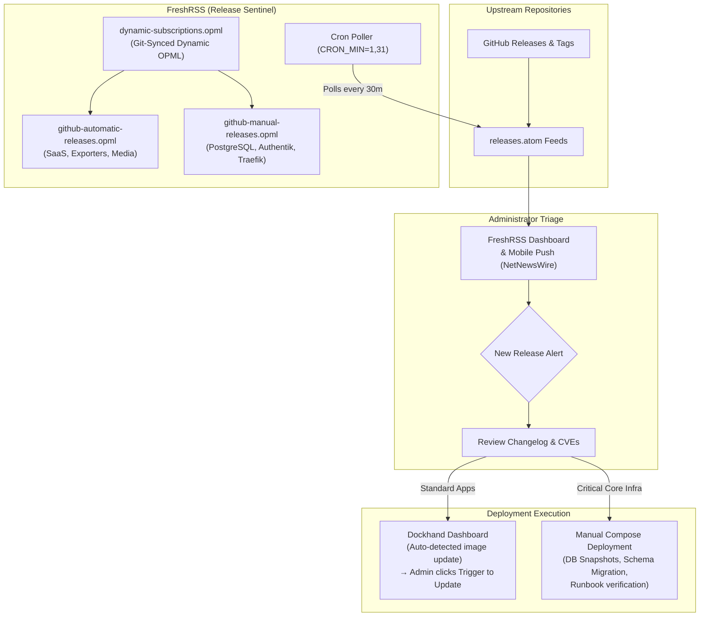

# FreshRSS — RSS Feed Aggregator & Sync Engine

[](https://freshrss.org/)
[](https://goauthentik.io)
[](https://www.postgresql.org)
[](https://traefik.io)

> **Ingress URL:** `https://freshrss.205hlab.com`  
> **Upstream Project:** [FreshRSS/FreshRSS](https://github.com/FreshRSS/FreshRSS)  
> **Category:** Household SaaS / Information Retrieval

FreshRSS is a lightweight, responsive RSS and Atom feed aggregator. It enables automated periodic polling of technical blogs, GitHub releases, news channels, and security advisories with Fever and Google Reader API compatibility for mobile apps (e.g. NetNewsWire, Reeder). In this homelab, FreshRSS uses PostgreSQL 18 for high-throughput article archiving, automated background cron updates, and native Authentik OpenID Connect (OIDC) authentication.

---

## 🏗️ Architecture & Dependencies

```
[ Client Browser / Mobile Reader App ]
        │ HTTPS (Cloudflare ACME TLS)
        ▼
[ Traefik Proxy (:443) ]
        │ Internal Docker Bridge (traefik_network)
        ▼
[ FreshRSS Container (:80) ]
   ├── OIDC Identity Provider ──► Authentik (https://authentik.205hlab.com)
   ├── Database Engine ──► PostgreSQL 18 (postgres_network)
   ├── App Data Mount ──► Named Volume: freshrss-data (/var/www/FreshRSS/data)
   └── Custom Extensions ──► Named Volume: freshrss-extensions (/var/www/FreshRSS/extensions)
```

- **Networks:**
  - `traefik_network` (external bridge): Receives incoming HTTPS traffic from Traefik.
  - `postgres_network` (external bridge): Direct communication with central PostgreSQL 18.
- **Database:** Dedicated database `freshrss` on PostgreSQL 18, isolated user `freshrss_app`.
- **Resource Constraints:** Governed with `limits: cpus: '1.0'`, `memory: 512M`.
- **Automated Cron Polling:** Feed updates execute automatically via internal cron every 30 minutes (`CRON_MIN=1,31`).

---

## 🔐 Authentik Integration (Method 1: Native OIDC)

FreshRSS integrates natively with Authentik via Apache `mod_auth_openidc` built into the Debian-based FreshRSS container image.

### 1. Authentik Provider Setup
1. In the Authentik Admin Interface, navigate to **Applications** > **Providers** > **Create**.
2. Select **OAuth2/OpenID Connect Provider**:
   - **Name:** `FreshRSS Provider`
   - **Client Type:** `Confidential`
   - **Redirect URIs (Strict):**
     - `https://freshrss.205hlab.com/i/oidc/`
     - `https://freshrss.205hlab.com:443/i/oidc/`
   - **Logout URI (Optional):** `https://freshrss.205hlab.com/i/oidc/?logout=backchannel` (Back-channel)
   - **Signing Key:** Select your default certificate/signing key.
   - **Selected Scopes:** `openid`, `email`, `profile`.
3. Click **Submit** and note the **Client ID** and **Client Secret**.

### 2. Authentik Application & Policy
1. Navigate to **Applications** > **Applications** > **Create**:
   - **Name:** `FreshRSS`
   - **Slug:** `freshrss`
   - **Provider:** Select `FreshRSS Provider`.
2. Under **Application** > **Policy / Group Bindings**, bind the group `freshrss_users` so only authorized household members can access the reader.

### 3. Container OIDC Parameters
These environment variables are pre-configured in `compose.yaml`:
```yaml
environment:
  - OIDC_ENABLED=1
  - OIDC_PROVIDER_METADATA_URL=https://authentik.205hlab.com/application/o/freshrss/.well-known/openid-configuration
  - OIDC_CLIENT_ID=${OIDC_CLIENT_ID}
  - OIDC_CLIENT_SECRET=${OIDC_CLIENT_SECRET}
  - OIDC_CLIENT_CRYPTO_KEY=${OIDC_CLIENT_CRYPTO_KEY}
  - OIDC_X_FORWARDED_HEADERS=X-Forwarded-Port X-Forwarded-Proto X-Forwarded-Host
  - OIDC_SCOPES=openid email profile
```

---

## 📡 Upstream Release Sentinel & OPML Feed Architecture

In `205hlab`, FreshRSS serves a dual purpose: beyond aggregating personal articles and technical blogs, it functions as an **Infrastructure Release Sentinel**. It continuously monitors upstream GitHub releases across all containers deployed in the homelab, acting as the primary early-warning system for application updates, security advisories, and breaking changes.



### 1. Feed Structure (`compose/freshrss/rss-feeds/`)

All release feeds are version-controlled in the repository under `compose/freshrss/rss-feeds/`:

| File | Purpose | Management Tier | Target Workloads |
| :--- | :--- | :--- | :--- |
| **`dynamic-subscriptions.opml`** | Master Dynamic OPML index | Git-Driven Dynamic Feed | Root feed referencing the automated and manual OPML files via `frss:opmlUrl`. |
| **`github-automatic-releases.opml`** | Routine & standard service updates | Dockhand / Automated Notification | Media automation (Radarr, Sonarr, Bazarr, Jellyfin), utilities (BentoPDF, Draw.io, IT-Tools, Mealie, Paperless-ngx), Prometheus exporters. |
| **`github-manual-releases.opml`** | Mission-critical infrastructure | Manual Runbook & Verification | Database engines (PostgreSQL 18, TimescaleDB, Redis, Valkey), IAM (Authentik), Ingress (Traefik v3), DNS (Technitium), Core Monitoring (Prometheus, Grafana), VPN (Gluetun). |

> [!TIP]
> **CDN Brand Icons:** Each feed outline in the OPML files references its official brand SVG icon located in `assets/icons/` via the jsDelivr CDN (`https://cdn.jsdelivr.net/gh/Dr20Ervin/205hlab@main/assets/icons/<app>.svg`). This gives instant visual recognition in both the FreshRSS web interface and native mobile clients (e.g., NetNewsWire, Reeder).

### 2. Dynamic OPML Synchronization

FreshRSS features native support for **Dynamic OPML** outlines (`xmlns:frss="https://freshrss.org/opml"`). Rather than manually adding or editing feeds inside the FreshRSS web interface:

1. The root `dynamic-subscriptions.opml` links to the raw GitHub URLs of `github-automatic-releases.opml` and `github-manual-releases.opml`.
2. Whenever a new container or tool is added to `205hlab`, its `.atom` release feed is committed to the relevant OPML file in git.
3. FreshRSS automatically pulls the updated OPML outlines from GitHub on its scheduled refresh interval, seamlessly importing new feeds without administrative overhead.

### 3. Update Lifecycle: Dockhand vs. Manual Intervention

When FreshRSS detects a new upstream release, the update is handled according to its risk tier:

1. **Automated Detection & Dockhand-Assisted Updates (`github-automatic-releases.opml`):**
   - Upstream image updates are automatically detected by **Dockhand** (or container monitoring).
   - FreshRSS alerts the administrator with the full markdown changelog.
   - The administrator inspects the changelog to confirm no environment variable syntax or volume layout has changed.
   - The administrator logs into **Dockhand** and clicks the manual trigger button to pull the new image and redeploy the container with zero CLI friction.

2. **Critical Core Infrastructure Updates (`github-manual-releases.opml`):**
   - Core infrastructure components (PostgreSQL, Authentik, Traefik, Technitium DNS) can cause cascading homelab outages if upgraded blindly.
   - The administrator reads the release notes in FreshRSS, checking for database schema migrations, deprecated configuration directives, or authentication flow changes.
   - The administrator creates a manual database snapshot / backup.
   - The upgrade is executed manually via the terminal:
     ```bash
     cd compose/<service>
     docker compose pull
     docker compose up -d
     docker compose logs -f
     ```

### 4. How to Import the Dynamic Feeds

To link your FreshRSS instance to the repository release feeds:

1. Log into FreshRSS at `https://freshrss.205hlab.com`.
2. Go to **Subscription Management** (cog icon > *Subscription Management*).
3. Select **Import / Export** > **Import**.
4. In the **Dynamic OPML URL** field, enter:
   ```text
   https://raw.githubusercontent.com/Dr20Ervin/205hlab/main/compose/freshrss/rss-feeds/dynamic-subscriptions.opml
   ```
5. Click **Import**. FreshRSS will automatically create two synchronized folders: `205hlab - Updates` and `205hlab - Manual Updates`.

---

## ⚙️ Environment Configuration

| Variable | Description | Default / Example |
| :--- | :--- | :--- |
| `FQDN` | Base domain name | `205hlab.com` |
| `TZ` | Container timezone | `UTC` |
| `CRON_MIN` | Polling schedule interval | `1,31` (every 30 mins) |
| `POSTGRES_HOST` | Database host | `postgres` |
| `POSTGRES_PORT` | Database port | `5432` |
| `POSTGRES_DB` | Database name | `freshrss` |
| `POSTGRES_USER` | Database username | `freshrss_app` |
| `POSTGRES_PASSWORD` | Database password | *(generated via `setup_secrets.sh`)* |
| `ADMIN_USER` | Default administrator username | *(matches your Authentik username)* |
| `ADMIN_PASSWORD` | Fallback admin password | *(generated via `setup_secrets.sh`)* |
| `OIDC_CLIENT_ID` | Authentik OAuth2 Client ID | *(from Authentik provider)* |
| `OIDC_CLIENT_SECRET` | Authentik OAuth2 Client Secret | *(from Authentik provider)* |
| `OIDC_CLIENT_CRYPTO_KEY`| Random encryption string | *(generated via `openssl rand -hex 16`)* |

---

## 🚀 Deployment & First-Time Setup

1. **Provision Database & User**:
   Execute `db-init.sql` against PostgreSQL:
   ```sql
   CREATE DATABASE freshrss;
   CREATE USER freshrss_app WITH ENCRYPTED PASSWORD '...';
   GRANT ALL PRIVILEGES ON DATABASE freshrss TO freshrss_app;
   ```

2. **Initialize Secrets & Environment**:
   ```bash
   cd compose/freshrss
   cp example.env .env
   chmod +x setup_secrets.sh && ./setup_secrets.sh
   nano .env # Set FQDN, OIDC_CLIENT_ID, OIDC_CLIENT_SECRET, and OIDC_CLIENT_CRYPTO_KEY
   ```

3. **Start the Stack**:
   ```bash
   docker compose up -d
   ```

4. **Verify Single Sign-On**:
   Navigate to `https://freshrss.205hlab.com`. You will be automatically redirected to Authentik for authentication and returned to your personal feed reading dashboard.

---

## 💾 Backup & Data Persistence

- **Feed Articles & Subscriptions**: Persisted in PostgreSQL (`freshrss` database). Backed up with standard database snapshots.
- **User Configurations & OPML**: Stored in named volume `freshrss_data` (`/var/www/FreshRSS/data`).
- **Installed Extensions**: Stored in named volume `freshrss_extensions`.

---

## 🩺 Healthcheck & Monitoring

- **Container Health**: Built-in CLI test `cli/health.php` executed every 60s.
- **Log Management**: Output capped with `max-size: 10m` to avoid log disk inflation during intensive feed polling.