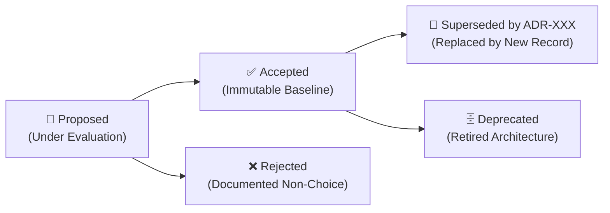

# Architecture Decision Records (ADRs)

> [!NOTE]
> **On Authorship & Documentation:**  
> All architectural evaluations, system designs, and operational decisions recorded here were **engineered by Vajda Ervin-Oliver** when establishing the `205hlab` production baseline. AI tooling was used strictly to structure and format this documentation from the author's design notes and repository configurations.

This directory contains the **Architecture Decision Records (ADRs)** for **`205hlab`** — documenting the *why* behind foundational technical choices across the data tier, identity & access management, split-horizon DNS, GitOps deployment, and physical hardware topology.

Rather than recording only *what* is deployed, each ADR captures the real-world constraints (32 GB DDR3 RAM ceiling, salvaged bare-metal hardware, apartment acoustics/power limits, and strict separation between production infrastructure and isolated dev VMs), the competing alternatives evaluated, the resulting trade-offs, and objective fitness checks.

---

## 📜 ADR Lifecycle & Governance

`205hlab` follows a **Hybrid MADR (Markdown Any Decision Records) + Michael Nygard** format paired with an **Immutable Snapshot Policy**:



- **Immutable Snapshot Rule:** Once an ADR transitions to `Accepted`, its original Context, Decision, and Consequences are **never rewritten in place**. They remain an accurate historical snapshot of the constraints and reasoning at the time of the decision.
- **Superseding Decisions:** When hardware, scale, or operational requirements evolve (for example, migrating to a multi-node K3s cluster or introducing automated offsite 3-2-1 backup orchestration), a **new ADR** must be authored that explicitly marks the previous record as `Superseded by ADR-XXX`.
- **Verification (Fitness Functions):** Each ADR defines concrete, observable checks in compose manifests, CI workflows, or runtime health endpoints to confirm ongoing compliance.

---

## 🗂️ Architecture Decision Log

| ID | Title | Domain | Status | Date |
| :--- | :--- | :--- | :--- | :--- |
| **[ADR-001](ADR-001-centralized-postgresql-18.md)** | Centralize Relational Application Data on a Hardened PostgreSQL 18 Instance | Data Tier & Persistence | `Accepted` | `2026-10` |
| **[ADR-002](ADR-002-authentik-unified-iam.md)** | Enforce Unified Zero-Trust IAM with Authentik (Native OIDC & Traefik ForwardAuth) | Security & IAM | `Accepted` | `2026-10` |
| **[ADR-003](ADR-003-split-horizon-technitium-dns.md)** | Deploy Split-Horizon Technitium DNS with RFC Catalog Zone HA Replication | Networking & DNS | `Accepted` | `2026-10` |
| **[ADR-004](ADR-004-dockhand-gitops-continuous-deployment.md)** | Adopt Dockhand for GitOps Continuous Deployment and Zero-Plaintext Secret Injection | CI/CD & Operations | `Accepted` | `2026-10` |
| **[ADR-005](ADR-005-decouple-smart-home-haos-appliance.md)** | Decouple Smart Home Infrastructure (HAOS) and Auxiliary DNS onto a Dedicated Hardware Appliance | Hardware & Topology | `Accepted` | `2026-10` |
| **[ADR-006](ADR-006-dual-instance-uptime-kuma-monitoring.md)** | Deploy Dual-Instance Uptime Kuma Monitoring Topology with Dedicated MariaDB and Out-of-Band HAOS Watchdog | Observability & Reliability | `Accepted` | `2026-11` |

---

## 📋 Hybrid ADR Template (Copy for `ADR-006+`)

```markdown
# ADR-XXX: [Imperative Decision Title]

| Field | Value |
| :--- | :--- |
| **Status** | `Proposed` \| `Accepted` \| `Deprecated` \| `Superseded by ADR-YYY` |
| **Date** | `YYYY-MM` |
| **Deciders** | Vajda Ervin-Oliver |
| **Domain** | `[Data Tier \| Security & IAM \| Networking & DNS \| CI/CD & Ops \| Hardware]` |
| **Related Stacks** | [`compose/<stack>/`](../../compose/) |

---

## Context and Problem Statement

[Describe the architectural forces, hardware/economic constraints, and specific problem being solved.]

## Decision Drivers

- **[Driver 1]:** [Constraint or goal.]
- **[Driver 2]:** [Constraint or goal.]

## Considered Options

1. **Option 1 (Chosen):** [Short name]
2. **Option 2:** [Alternative]
3. **Option 3:** [Alternative]

### Options Analysis

#### Option 1 — [Name]
- **Pros:** ...
- **Cons:** ...

#### Option 2 — [Name]
- **Pros:** ...
- **Cons:** ...

## Decision Outcome

**Chosen Option:** **[Option 1]**

[Explain how the solution is implemented in `205hlab`, including exact architectural boundaries or deliberate exceptions.]

## Consequences

### Positive Consequences
- ...

### Negative Consequences & Mitigations
- **Trade-off:** ... -> **Mitigation:** ...

## Compliance & Verification (Fitness Functions)

- [Objective check against repository manifests, CI pipelines, or runtime metrics.]
```
