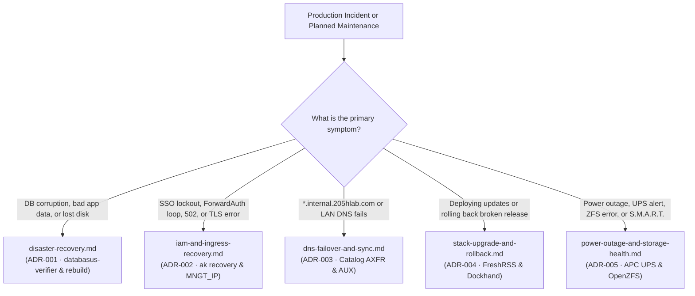

# Operational & Disaster Recovery Runbooks

> [!NOTE]
> **1-to-1 Architecture & Operations Symmetry:**  
> Every foundational **Architecture Decision Record ([`docs/adr/`](../adr/README.md))** in `205hlab` is paired directly with an executable **Standard Operating Procedure (SOP)** below. While ADRs capture *why* the architecture was chosen, these runbooks document *how* to diagnose, recover, upgrade, and verify production infrastructure under real-world incident conditions.

---

## 🚨 Master Runbook Catalog

| Runbook | Primary Scope | Severity / Trigger | Target RTO / SLA | Mapped ADR & Stacks |
| :--- | :--- | :--- | :--- | :--- |
| **[`disaster-recovery.md`](disaster-recovery.md)** | PostgreSQL 18 Restore Verification (`databasus-verifier`), Single-App Rollback, & Bare-Metal Rebuild | `SEV-1` Data Loss / Migration Failure / Routine Audit | `RPO: 24h` · `RTO: < 15m` *(single)* / `< 30m` *(cluster)* | [`ADR-001`](../adr/ADR-001-centralized-postgresql-18.md) · [`postgres`](../../compose/postgres/) · [`databasus`](../../compose/databasus/) |
| **[`iam-and-ingress-recovery.md`](iam-and-ingress-recovery.md)** | Authentik Lockout (`ak create_recovery_key`), ForwardAuth / OIDC Triage, `${MNGT_IP}` Bypass, & ACME TLS | `SEV-1` Global Auth Outage / Lockout / Cert Expiry | `RTO: < 5m` *(CLI recovery key & MNGT bypass)* | [`ADR-002`](../adr/ADR-002-authentik-unified-iam.md) · [`authentik`](../../compose/authentik/) · [`traefik`](../../compose/traefik/) |
| **[`dns-failover-and-sync.md`](dns-failover-and-sync.md)** | Technitium Split-Horizon Failover (`technitium-aux`), RFC Catalog Zone AXFR Sync, & DNSSEC | `SEV-1 / SEV-2` DNS Resolution Failure / Zone Drift | `RPO: ~0m` · `RTO: 0m` *(auto-failover to HAOS)* | [`ADR-003`](../adr/ADR-003-split-horizon-technitium-dns.md) · [`technitium`](../../compose/technitium/) · [`prom-exporters`](../../compose/prom-exporters/) |
| **[`stack-upgrade-and-rollback.md`](stack-upgrade-and-rollback.md)** | FreshRSS Release Sentinel -> Databasus Pre-Upgrade Snapshot -> Dockhand GitOps -> Rollback & Hawser | `MAINT / SEV-2` Planned Upgrades & Regressions | `RTO: < 5m` *(Git revert)* / `< 15m` *(with DB restore)* | [`ADR-004`](../adr/ADR-004-dockhand-gitops-continuous-deployment.md) · [CI](../../.github/workflows/validate-compose.yml) · [`freshrss`](../../compose/freshrss/) |
| **[`power-outage-and-storage-health.md`](power-outage-and-storage-health.md)** | APC Back-UPS XS 950U Events, Post-Outage Boot, OpenZFS Scrubs, S.M.A.R.T., & PG18 Checksums | `SEV-1 / MAINT` Utility Outage / Disk Alert | `RPO: 0m` *(ZFS mirror)* · `RTO: < 15m` *(post-boot audit)* | [`ADR-005`](../adr/ADR-005-decouple-smart-home-haos-appliance.md) · [`prom-exporters`](../../compose/prom-exporters/) · [Dashboards](../../grafana-dashboards/README.md) |

---

## 📅 Operational Maintenance & Drill Cadence

To guarantee that recovery procedures are tested and validated before emergencies occur, operational maintenance and failure drills are scheduled on recurring cycles tracked in **Vikunja** (`vikunja.205hlab.com`):

| Cadence | Domain / Type | Activity & Objective | Governing Runbook | Target Verification |
| :--- | :--- | :--- | :--- | :--- |
| **Monthly** | 🐧 *Maintenance* | **Host OS Security Updates & Dockhand Audit** | [`stack-upgrade-and-rollback.md`](stack-upgrade-and-rollback.md) | Ubuntu kernel security patches, apt cleanup, Dockhand image scan review |
| **Monthly** | 🗄️ *Maintenance* | **Post-Scrub Storage & S.M.A.R.T. Health Audit** | [`power-outage-and-storage-health.md`](power-outage-and-storage-health.md) | Auto-scrub `0 errors`, drive SMART attributes, NVMe wear level, pool capacity |
| **Monthly** | 💾 *Maintenance* | **Databasus Backup Retention & Health Review** | [`disaster-recovery.md`](disaster-recovery.md) | Green backup status across all tenants, `databasus-verifier` row matches |
| **Monthly** | 🌐 *Drill* | **Technitium Split-Horizon Failover Drill** | [`dns-failover-and-sync.md`](dns-failover-and-sync.md) | Stop primary DNS; confirm zero LAN downtime via `technitium-aux` on HAOS |
| **Monthly** | 💾 *Drill* | **PostgreSQL Isolated Restore Test** | [`disaster-recovery.md`](disaster-recovery.md) | Live dump restore into an ephemeral test DB; table & row count match |
| **Quarterly** | ⚡ *Maintenance* | **APC UPS Self-Test & Battery Telemetry Inspection** | [`power-outage-and-storage-health.md`](power-outage-and-storage-health.md) | NUT battery state, > 15m runtime under load, self-test routine execution |
| **Quarterly** | 📦 *Maintenance* | **Appliance Out-of-Band Config Exports** | [`disaster-recovery.md`](disaster-recovery.md) | Download OpenWrt `.tar.gz`, HAOS `.tar`, Technitium `.zip` to `/BinPool/backup-manual/` |
| **Quarterly** | 🚪 *Drill* | **Management VLAN (`MNGT_VLAN`) Bypass Audit** | [`iam-and-ingress-recovery.md`](iam-and-ingress-recovery.md) | Direct `${MNGT_IP}` console access without Traefik, Cloudflare, or Authentik SSO |
| **Semi-Annual** | 🔑 *Drill* | **Authentik Admin CLI Recovery Key Test** | [`iam-and-ingress-recovery.md`](iam-and-ingress-recovery.md) | `ak create_recovery_key` generates working incognito admin session |
| **Semi-Annual** | ⏪ *Drill* | **GitOps Fast Rollback & Revert Test** | [`stack-upgrade-and-rollback.md`](stack-upgrade-and-rollback.md) | Git revert on `main` triggers zero-downtime Dockhand rollback |
| **Annual** | 🧊 *Drill* | **Cold Bare-Metal Rebuild Readiness Dry-Run** | [`disaster-recovery.md`](disaster-recovery.md) | Verify offline USB boot, external passwords, and bootstrap script readiness |

---

## 🧭 Incident Triage Flowchart

---

## 🛠️ Emergency Break-Glass Management VLAN (`${MNGT_IP}`) Endpoints

When **Traefik** (`traefik.205hlab.com`), **Authentik SSO** (`authentik.205hlab.com`), or internal **DNS** (`*.internal.205hlab.com`) is degraded, administrative consoles remain directly reachable over the isolated Management VLAN (`MNGT_VLAN`):

| Service | Direct Break-Glass URL | Stack | Governing Runbook |
| :--- | :--- | :--- | :--- |
| **Traefik Dashboard & API** | `http://${MNGT_IP}:8080` | [`compose/traefik/`](../../compose/traefik/) | [`iam-and-ingress-recovery.md`](iam-and-ingress-recovery.md) |
| **Technitium DNS Admin (HTTP)** | `http://${MNGT_IP}:5380` | [`compose/technitium/`](../../compose/technitium/) | [`dns-failover-and-sync.md`](dns-failover-and-sync.md) |
| **Technitium DNS Admin (HTTPS)** | `https://${MNGT_IP}:53443` | [`compose/technitium/`](../../compose/technitium/) | [`dns-failover-and-sync.md`](dns-failover-and-sync.md) |
| **OpenSpeedTest (MNGT Bind)** | `http://${MNGT_IP}:3000` *(default `${OPENSPEEDTEST_MNGT_PORT}`)* | [`compose/network-mon/`](../../compose/network-mon/) | [`iam-and-ingress-recovery.md`](iam-and-ingress-recovery.md) |
| **MyIP Network Diagnostics** | `http://${MNGT_IP}:18966` *(default `${MYIP_PORT}`)* | [`compose/network-mon/`](../../compose/network-mon/) | [`iam-and-ingress-recovery.md`](iam-and-ingress-recovery.md) |
