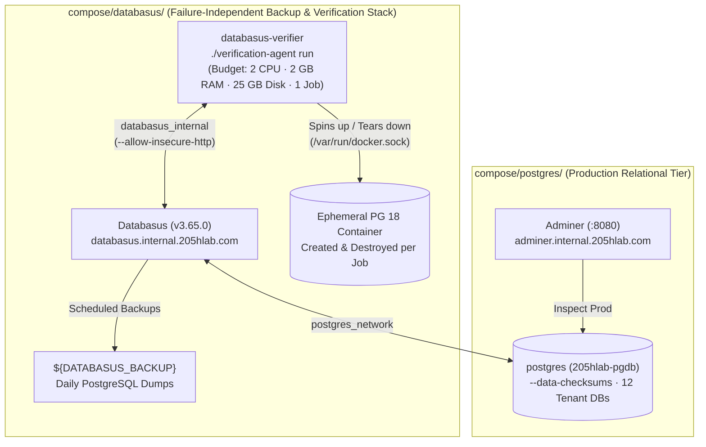

# Disaster Recovery & PostgreSQL Restore Verification Runbook

> [!NOTE]
> **Operational Purpose:**  
> This runbook defines `205hlab`'s **Recovery Point Objectives (RPO)**, **Recovery Time Objectives (RTO)**, automated **Databasus Restore Verification (`databasus-verifier`)**, on-demand manual restore drills, single-database rollbacks, and full bare-metal cold rebuild recovery.  
> **Navigation:** [`Runbooks Index`](README.md) · **Related Architecture:** [`ADR-001`](../adr/ADR-001-centralized-postgresql-18.md) · [`compose/postgres/`](../../compose/postgres/) · [`compose/databasus/`](../../compose/databasus/)

---

## 📊 Service Recovery Objectives (RPO & RTO Matrix)

| Tier | Workload / Component | Backup & Resilience Mechanism | RPO *(Max Data Loss)* | Target RTO *(Recovery Time)* |
| :--- | :--- | :--- | :--- | :--- |
| **Tier 0: Split-Horizon DNS** | Technitium DNS (`internal.205hlab.com`, LAN DNS) | Real-time RFC Catalog Zone replication to `technitium-aux` on HAOS ([ADR-003](../adr/ADR-003-split-horizon-technitium-dns.md)) | **~0 min** *(AXFR/IXFR)* | **0 min** *(Automatic LAN failover to ASUS X540SA)* |
| **Tier 1: Compose & Stateless Ingress** | All 21 `compose.yaml` templates, Traefik, SearXNG, Web Tools | GitHub (`Dr20Ervin/205hlab`) + Dockhand Encrypted Vault ([ADR-004](../adr/ADR-004-dockhand-gitops-continuous-deployment.md)) | **0 min** *(Git-tracked)* | **< 10 min** *(Git sync / clone + `docker compose up -d`)* |
| **Tier 2: Central Relational Tier** | PostgreSQL 18 (`authentik`, `paperless`, `mealie`, `freshrss`, `*arr`, `qui`, `resume`, `speedtest`) | Automated **daily** scheduled dumps + **After backup** restore verification via **Databasus** (`databasus-verifier`) | **24 hours** *(Daily schedule)* | **< 15 min** *(Single DB rollback)* / **< 30 min** *(Full PG18 cluster rebuild)* |
| **Tier 3: Archives & Bulk Media** | Paperless-ngx PDFs, identity certs, OpenZFS media pool | OpenZFS mirror (disk redundancy) + manual multi-device copies *(3-2-1 cloud pipeline in progress)* | **0 min** *(Single disk fault)* / **Manual sync cadence** *(Host loss)* | **30–60 min** *(Local LAN restore)* |

---

## 🏗️ Decoupled Backup & Automated Verification Architecture



**Why Databasus + `databasus-verifier` follow this design:**
1. **Availability During Outages:** Stopping or upgrading `postgres` (`205hlab-pgdb`) never stops `databasus` — backup archives and the restore UI remain accessible during database recovery.
2. **Proof Beyond Checksums:** Checksums only prove archive bits didn't flip; **`databasus-verifier`** automatically restores each backup into an ephemeral `postgres:18` container, validates schema and per-table row counts against the source, tears the throwaway container down (zero idle DB RAM wasted), and logs every attempt in Databasus's **Restore verifications** tab.
3. **Strict Ingress Security:** `databasus-verifier` communicates over the private `databasus_internal` Docker bridge (`http://databasus:4005 --allow-insecure-http`) so `https://databasus.internal.205hlab.com` stays 100% locked behind Authentik `ForwardAuth` without auth bypasses.

---

## ⚠️ Five Critical Rules Before Any Restore

> [!CAUTION]
> Always verify these five preconditions before touching a production PostgreSQL database:

1. **Always Stop the Target Application Container First:**  
   Never restore into a production database while the consuming container (`mealie`, `paperless`, `authentik`, `sonarr`, etc.) is running. Open connection pools block `DROP DATABASE` / `CREATE DATABASE` and background workers can immediately overwrite or corrupt freshly restored rows.
2. **Match Role Ownership (`db-init.sql` vs. Ephemeral Drills):**  
   Each production database is owned by a dedicated role (`authentik_app`, `paperless_app`, `mealie_app`, `sonarr_app`, etc.).
   - For **Production / Full Cluster Recovery:** Execute `db-init.sql` first so roles exist before importing.
   - For **Manual CLI Ephemeral Drills:** Either create the matching role first OR pass `--no-owner --no-privileges` (on custom/tar `pg_restore` dumps) into a throwaway test database.
3. **Always Verify Block Checksums After Production Recovery:**  
   Production `postgres` initializes with `POSTGRES_INITDB_ARGS=--data-checksums`. Run a `pg_stat_database` query after every production restore to confirm `checksum_failures = 0`.
4. **Take a Pre-Rollback Snapshot of the Broken State:**  
   If an upgrade broke an app's database and you plan to roll back to yesterday's backup, save one quick `pg_dump` of the current state first in case you later need to extract specific new rows manually.
5. **Tear Down Ephemeral Manual Drill Containers Immediately:**  
   Automated `databasus-verifier` jobs destroy temporary containers automatically; if you launch a manual CLI sandbox (`pg-manual-drill`) with `docker run --rm`, always `docker stop` it right after inspecting tables so no idle Postgres instance or unmaintained copy of production data remains running.

---

## 🧪 Scenario 1: Automated Restore Verification & On-Demand Manual Drills

*"A backup is only a hypothesis until you restore it."*

### Method A — Automated "After Backup" Verification (`databasus-verifier` · Default)

1. Confirm `databasus-verifier` is healthy and registered:
   ```bash
   docker ps --filter "name=databasus"
   docker logs --tail 50 databasus-verifier
   ```
2. In **Databasus** (`https://databasus.internal.205hlab.com`, Authentik `pgdb_admins`):
   - Confirm your agent (`205hlab-prod-verifier`) shows online under **Settings -> Verification agents**.
   - On each production database -> **Restore verifications** tab -> verify **Scheduled verification** is set to **After backup** (automatically cancels stale queued runs if a newer backup arrives) and wire failure notifications (**Verification failed** checked; **Verification success** optional to prevent alert fatigue).
3. **Inspect Verification History:** Open any database's **Restore verifications** tab to confirm **`Successful`** status, elapsed duration (actual measured RTO), restored DB size, schema/table counts, and per-table row-count breakdown.
4. **Spot-Check Anytime:** Click **Verify** on a recent backup in the UI to trigger an immediate one-off verification run without altering schedules.

### Method B — Manual Human CLI + Adminer Inspection Drill (`docker run --rm`)

Use this procedure when a human operator wants to manually load and browse restored tables in **Adminer** (`https://adminer.internal.205hlab.com`) during quarterly DR practice:

1. **Inspect available backups on the host (`${DATABASUS_BACKUP}`, e.g. `/mnt/storage/backups/postgres`):**
   ```bash
   ls -lh /mnt/storage/backups/postgres
   ```

2. **Spin up a throwaway PostgreSQL 18.3 container on `postgres_network` (`--rm` removes it automatically on stop):**
   ```bash
   docker run --rm -d \
     --name pg-manual-drill \
     --network postgres_network \
     -e POSTGRES_INITDB_ARGS="--data-checksums" \
     -e POSTGRES_USER=drill_admin \
     -e POSTGRES_PASSWORD=drill_temp_pass \
     -e POSTGRES_DB=drill_verify \
     docker.io/library/postgres:18.3
   ```
   Wait until healthy (`docker exec pg-manual-drill pg_isready -U drill_admin`).

3. **Stream the backup into `pg-manual-drill` (`time` measures actual human + CLI RTO):**
   - *For plain SQL or gzipped SQL dumps (`.sql` / `.sql.gz`):*
     ```bash
     time bash -c 'gunzip -c /mnt/storage/backups/postgres/<dump-file>.sql.gz | docker exec -i pg-manual-drill psql -v ON_ERROR_STOP=1 -U drill_admin -d drill_verify'
     ```
   - *For PostgreSQL custom-format dumps (`.dump`):*
     ```bash
     time bash -c 'docker exec -i pg-manual-drill pg_restore -U drill_admin -d drill_verify --no-owner --no-privileges < /mnt/storage/backups/postgres/<dump-file>.dump'
     ```

4. **Verify tables, checksums, and optionally browse in Adminer:**
   ```bash
   docker exec -it pg-manual-drill psql -U drill_admin -d drill_verify -c "\dt"
   docker exec -it pg-manual-drill psql -U drill_admin -d postgres -c "SELECT datname, checksum_failures FROM pg_stat_database WHERE datname = 'drill_verify';"
   ```
   *(Optional: open `https://adminer.internal.205hlab.com`, select Server `pg-manual-drill`, User `drill_admin`, Database `drill_verify`.)*

5. **Tear down cleanly (`--rm` deletes the container & temp storage automatically):**
   ```bash
   docker stop pg-manual-drill
   ```

---

## 🛠️ Scenario 2: Single-Application Production Database Rollback

Use this procedure when **one application** (e.g., `mealie`, `paperless`, or `sonarr-main`) experiences bad migrations or accidental deletion, without disrupting the other 11 production databases on `postgres` (`205hlab-pgdb`).

### Step 1 — Stop Only the Affected Application Stack

```bash
cd /opt/205hlab/compose/<stack-name>
docker compose stop <service-name>
# Example: cd /opt/205hlab/compose/mealie && docker compose stop mealie
```

*(Alternatively, stop only that container from the **Dockhand** UI at `https://dockhand.internal.205hlab.com`.)*

### Step 2 — Terminate Any Lingering Client Connections

```bash
docker exec -it postgres psql -U "$POSTGRES_USER" -d postgres -c "
SELECT pg_terminate_backend(pid)
FROM pg_stat_activity
WHERE datname = '<target_db_name>' AND pid <> pg_backend_pid();
"
```

### Step 3 — Safety Dump + Drop & Recreate Clean Target DB

```bash
# 1. Optional safety backup of pre-rollback state
docker exec -t postgres pg_dump -U "$POSTGRES_USER" "<target_db_name>" > "/tmp/pre_rollback_<target_db_name>_$(date +%F_%H%M).sql"

# 2. Drop and recreate database owned by its dedicated *_app role
docker exec -it postgres psql -U "$POSTGRES_USER" -d postgres -c "DROP DATABASE \"<target_db_name>\";"
docker exec -it postgres psql -U "$POSTGRES_USER" -d postgres -c "CREATE DATABASE \"<target_db_name>\" OWNER \"<app_role>\";"
```

### Step 4 — Restore Backup & Restart Service

- **Via Databasus UI:** Trigger **Restore** on the target backup snapshot in `https://databasus.internal.205hlab.com`.
- **Via CLI:**
  ```bash
  gunzip -c /mnt/storage/backups/postgres/<backup-file>.sql.gz | docker exec -i postgres psql -v ON_ERROR_STOP=1 -U "$POSTGRES_USER" -d "<target_db_name>"
  ```

Verify checksums and restart the application:

```bash
docker exec -it postgres psql -U "$POSTGRES_USER" -d postgres -c "SELECT datname, checksum_failures FROM pg_stat_database WHERE datname = '<target_db_name>';"
cd /opt/205hlab/compose/<stack-name> && docker compose start <service-name>
docker compose ps
```

---

## 💥 Scenario 3: Total Catastrophic Bare-Metal Rebuild (Full Cluster)

Use this procedure when recovering `205hlab` onto a replacement SSD or freshly installed Ubuntu Server LTS host.

### Step 1 — Bootstrap Host Networks & Core Persistence

```bash
docker network create traefik_network
docker network create postgres_network
docker network create monitoring_network
docker network create servarr_backend

git clone https://github.com/Dr20Ervin/205hlab.git /opt/205hlab
cd /opt/205hlab
```

Launch **Traefik**, **PostgreSQL 18** (`--data-checksums`), and **Databasus** first (either via Dockhand GitOps + Vault injection or manual `.env` fallback from [README.md](../../README.md#-manual-cli-deployment-fallback--disaster-recovery)):

```bash
cd /opt/205hlab/compose/postgres && docker compose up -d
cd /opt/205hlab/compose/databasus && docker compose up -d databasus
```

Wait until PostgreSQL reports healthy (`docker exec postgres pg_isready -U "$POSTGRES_USER"`).

### Step 2 — Provision All Tenant Roles & Empty Databases (`db-init.sql`)

Execute every stack's version-controlled `db-init.sql` before restoring dumps so all least-privilege roles (`authentik_app`, `paperless_app`, etc.) exist:

```bash
for sql in /opt/205hlab/compose/*/db-init.sql; do
  echo "Applying $sql ..."
  docker exec -i postgres psql -U "$POSTGRES_USER" -d postgres < "$sql"
done
```

### Step 3 — Restore All Databases from `${DATABASUS_BACKUP}`

- Copy your retained PostgreSQL backup archives into `${DATABASUS_BACKUP}` (from secondary physical LAN storage or encrypted offsite backup).
- Restore each tenant database either via **Databasus UI** (`https://databasus.internal.205hlab.com`) or using the `psql` / `pg_restore` loop targeting each archive.
- Register and start `databasus-verifier` (`docker compose up -d` in `compose/databasus/`) once restored UI/schedules are active.
- Restore non-PostgreSQL stateful volumes (**TimescaleDB** for `tracearr`, **Paperless** `media/` originals, **Technitium** zone exports or automatic sync back from `technitium-aux` on HAOS).

### Step 4 — Verify Cluster Integrity & Boot Remaining Stacks

1. **Audit all databases in PostgreSQL 18:**
   ```bash
   docker exec -it postgres psql -U "$POSTGRES_USER" -d postgres -c "SELECT datname, numbackends, checksum_failures FROM pg_stat_database ORDER BY datname;"
   ```
   Confirm `checksum_failures` is `0` across every row.
2. **Deploy remaining stacks** in the 1–21 startup sequence documented in [`README.md`](../../README.md#recommended-stack-startup-order) (`authentik` → `technitium` → monitoring → productivity & media).

---

## 📝 Restore Drill Audit Log

| Date | Drill Type | Target Database | Backup Snapshot | Destination Host | Measured RTO | `checksum_failures` | Outcome |
| :--- | :--- | :--- | :--- | :--- | :--- | :--- | :--- |
| `2026-11-15` | Runbook Baseline | *(Pending first `databasus-verifier` run)* | `${DATABASUS_BACKUP}` | `databasus-verifier` (Ephemeral PG18) | *Target: `< 15m`* | `—` | 🟡 Ready for first automated check |
