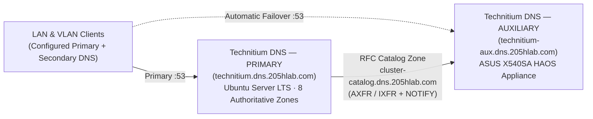

# DNS Failover & Catalog Zone Synchronization Runbook (Technitium DNS)

> [!NOTE]
> **Operational Purpose:**  
> Procedures for verifying **automatic LAN DNS failover** to **`technitium-aux`** (HAOS on ASUS X540SA), auditing and resynchronizing the **RFC Catalog Zone (`cluster-catalog.dns.205hlab.com`)**, validating **DNSSEC signatures**, and accessing the console via **Management VLAN bypass (`${MNGT_IP}:5380`)**.  
> **Navigation:** [`Runbooks Index`](README.md) · **Related Architecture:** [`ADR-003`](../adr/ADR-003-split-horizon-technitium-dns.md) · [`ADR-005`](../adr/ADR-005-decouple-smart-home-haos-appliance.md) · [`compose/technitium/`](../../compose/technitium/) · [Technitium Dashboard JSON](../../grafana-dashboards/core/technitium-dns-dashbaord.json)

---

## 🏗️ Split-Horizon Dual-Node Replication Architecture



**8 Authoritative & Managed Zones:**
1. `205hlab.com` *(Forwarder zone with local split-horizon overrides)*
2. `internal.205hlab.com` *(Primary — resolves all `*.internal.205hlab.com` LAN-only routes)*
3. `dns.205hlab.com` *(Primary — DNSSEC-signed resolver infrastructure zone)*
4. `lan.205hlab.com` *(Primary — local LAN client DHCP/static records)*
5. `mngt.205hlab.com` *(Primary — Management VLAN `10.14.0.0/24` interfaces)*
6. `cluster-catalog.dns.205hlab.com` *(Catalog zone automating member-zone discovery & replication)*
7. `0.10.10.in-addr.arpa` *(Primary — reverse PTR for `10.10.0.0/24`)*
8. `0.14.10.in-addr.arpa` *(Primary — reverse PTR for `10.14.0.0/24`)*

**Service Level Objectives:**
- **RPO:** `~0 minutes` *(Continuous DNS `NOTIFY` + `AXFR`/`IXFR` replication)*
- **Target RTO (Primary Server Outage / Reboot):** `0 minutes` *(Seamless household failover to `technitium-aux` on HAOS)*

---

## 🔁 Procedure 1: Verifying Automatic LAN Failover (`technitium-aux`)

Run these checks before performing scheduled maintenance on the primary Ubuntu Server (or to verify failover health after an unexpected outage):

1. **Test internal split-horizon resolution against BOTH nameservers:**
   ```bash
   # Primary node (Ubuntu Server)
   dig @<PRIMARY_DNS_IP> adminer.internal.205hlab.com +short
   dig @<PRIMARY_DNS_IP> databasus.internal.205hlab.com +short

   # Auxiliary node (ASUS X540SA HAOS)
   dig @<AUX_DNS_IP> adminer.internal.205hlab.com +short
   dig @<AUX_DNS_IP> databasus.internal.205hlab.com +short
   ```
   Both servers must return the exact same internal Traefik/LAN IPv4 address.

2. **Test WAN/hairpin override and reverse PTR records on `technitium-aux`:**
   ```bash
   dig @<AUX_DNS_IP> authentik.205hlab.com +short
   dig @<AUX_DNS_IP> -x <PRIMARY_SERVER_LAN_IP> +short
   ```

3. **Test upstream recursive forwarding (`1.1.1.1`, `9.9.9.9`):**
   ```bash
   dig @<AUX_DNS_IP> github.com +short
   ```

4. **Check Grafana Telemetry:** Open [`technitium-dns-dashbaord.json`](../../grafana-dashboards/core/technitium-dns-dashbaord.json) (`technitium-exporter`, scraping `technitium.dns.205hlab.com` and `technitium-aux.dns.205hlab.com`) and verify both nodes show active metrics without spike in `SERVFAIL` / `REFUSED` responses.

---

## 🔄 Procedure 2: Auditing & Forcing RFC Catalog Zone Synchronization

If zone edits made on `technitium` (Primary) do not immediately appear on `technitium-aux` (Secondary):

### Step 1 — Compare SOA Serial Numbers Across Nodes

```bash
dig @<PRIMARY_DNS_IP> internal.205hlab.com SOA +short
dig @<AUX_DNS_IP>     internal.205hlab.com SOA +short

dig @<PRIMARY_DNS_IP> cluster-catalog.dns.205hlab.com SOA +short
dig @<AUX_DNS_IP>     cluster-catalog.dns.205hlab.com SOA +short
```

If the SOA serial on `<AUX_DNS_IP>` lags behind `<PRIMARY_DNS_IP>`, zone transfer (`NOTIFY` / `AXFR`) was blocked or delayed.

### Step 2 — Check Primary Container & Network Reachability

1. On the Ubuntu Server, check Technitium logs for `AXFR`, `IXFR`, or `NOTIFY` errors:
   ```bash
   docker logs --tail 100 technitium | grep -iE "catalog|axfr|ixfr|notify|error"
   ```
2. Verify TCP port `53` is reachable between the Ubuntu Server and ASUS X540SA across the OpenWrt firewall/VLAN rules (`ports: "53:53/tcp"` is required for AXFR zone transfers; UDP alone is insufficient).
3. On Primary UI (`https://technitium.internal.205hlab.com`):
   - Inspect **Zones -> `cluster-catalog.dns.205hlab.com` -> Zone Options** and verify **Zone Transfer Allowed Networks / TSIG** includes the auxiliary node.
4. On Auxiliary UI (`technitium-aux` on HAOS):
   - Open **Zones -> `cluster-catalog.dns.205hlab.com`** (or affected Secondary zone) and click **Resync** to force an immediate `AXFR` pull.
   - Or inspect `technitium-aux` container logs via **Dockhand -> Hawser Agent** ([ADR-004](../adr/ADR-004-dockhand-gitops-continuous-deployment.md)).

---

## 🔐 Procedure 3: Auditing DNSSEC Signing on `dns.205hlab.com`

`dns.205hlab.com` is signed with **DNSSEC**. When auditing signatures or troubleshooting validation errors:

1. **Query `DNSKEY` and `RRSIG` records directly:**
   ```bash
   dig @<PRIMARY_DNS_IP> dns.205hlab.com DNSKEY +dnssec
   dig @<AUX_DNS_IP>     dns.205hlab.com SOA +dnssec
   ```
   Confirm the `ad` (Authenticated Data) flag or valid `RRSIG` records appear.
2. Check **Zones -> `dns.205hlab.com` -> DNSSEC Properties** in the Technitium UI to confirm active KSK/ZSK keys and verify there are no expired signature timestamps (for example, after prolonged clock drift following a power outage — verify `timedatectl` NTP sync on Ubuntu Server!).

---

## 🛠️ Procedure 4: Emergency Local Console Login (`${MNGT_IP}:5380`)

If **Traefik** or **Authentik OIDC** (`https://technitium.internal.205hlab.com`) is offline — including circular dependency situations where DNS broke before Authentik came up:

1. Bypass Traefik and OIDC completely by browsing directly to the Management VLAN port:
   - **HTTP:** `http://${MNGT_IP}:5380`
   - **HTTPS:** `https://${MNGT_IP}:53443`
2. Log in using the local fallback `admin` account (`DNS_SERVER_ADMIN_PASSWORD` stored in Dockhand's encrypted vault / `.env`).
3. Keep port `5380`/`53443` bound **exclusively** to `${MNGT_IP}` (`10.14.0.0/24`) as defined in [`compose/technitium/compose.yaml`](../../compose/technitium/compose.yaml#L11-L12).

---

## ✅ Post-Recovery Verification Checklist

- [ ] SOA serials match between `technitium` and `technitium-aux` across all member zones under `cluster-catalog.dns.205hlab.com`.
- [ ] `internal.205hlab.com` returns private IPs inside LAN and remains unresolvable from public resolvers (`@1.1.1.1`).
- [ ] `dns.205hlab.com` returns valid `RRSIG` records and Ubuntu Server host clock (`timedatectl status`) is NTP-synchronized.
- [ ] [`technitium-dns-dashbaord.json`](../../grafana-dashboards/core/technitium-dns-dashbaord.json) shows healthy query/cache activity on both nodes.
