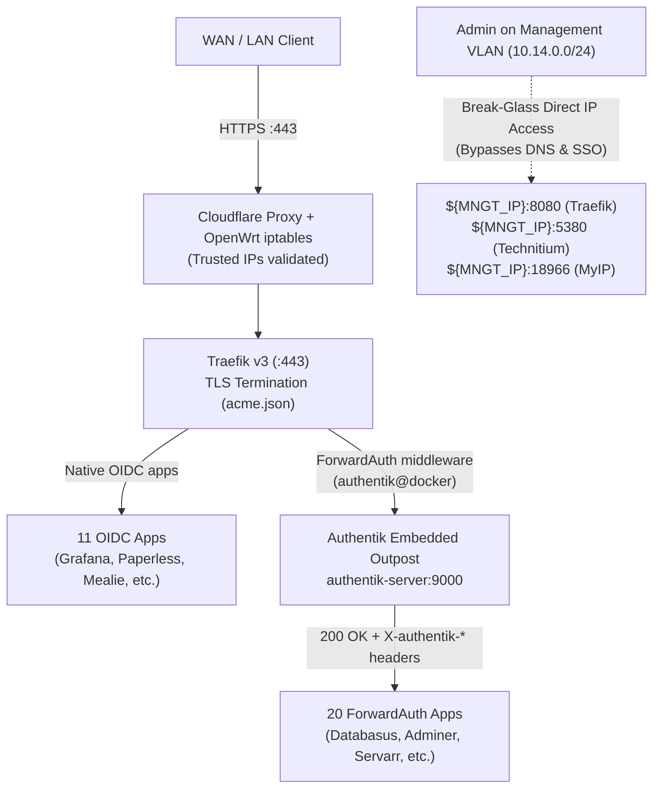

# IAM & Ingress Recovery Runbook (Authentik & Traefik v3)

> [!NOTE]
> **Operational Purpose:**  
> Standard operating procedures for recovering from **Authentik administrator lockouts**, diagnosing **`authentik@docker` ForwardAuth or OIDC failures**, using **Management VLAN (`${MNGT_IP}`) break-glass endpoints**, and resolving **Cloudflare DNS-01 ACME TLS certificate issues**.  
> **Navigation:** [`Runbooks Index`](README.md) · **Related Architecture:** [`ADR-002`](../adr/ADR-002-authentik-unified-iam.md) · [`compose/authentik/`](../../compose/authentik/) · [`compose/traefik/`](../../compose/traefik/) · [Traefik Dashboard JSON](../../grafana-dashboards/core/traefik.json)

---

## 🏗️ Ingress & Authentication Request Path



**Service Level Objectives:**
- **Target RTO (Admin Lockout / Recovery Key):** `< 5 minutes`
- **Target RTO (ForwardAuth Outage Remediation):** `< 10 minutes`

---

## 🔑 Procedure 1: Authentik Admin Lockout / Lost MFA Recovery

Use this procedure if the `akadmin` or primary admin account loses its WebAuthn/TOTP token or password.

1. **SSH into the primary Ubuntu Server** (Fujitsu ESPRIMO P710) and confirm `authentik-worker` is healthy:
   ```bash
   docker ps --filter "name=authentik"
   ```

2. **Generate a temporary, one-time recovery link** (valid for `10` minutes in this example):
   ```bash
   docker exec -it authentik-worker ak create_recovery_key 10 akadmin
   ```
   *(Replace `akadmin` with your target Authentik username if needed.)*

3. **Open the output URL** in your browser (formatted as `https://authentik.205hlab.com/recovery/use-token/...`).
4. Immediately navigate to **User Settings -> MFA Devices** (or **Directory -> Users**), delete the lost token, enroll a new passkey/TOTP authenticator, and update password rotation records.

---

## 🔄 Procedure 2: Recovering from ForwardAuth (`authentik@docker`) Loops or `500` / `502` Errors

Because **20 services** rely on Traefik's `authentik@docker` ForwardAuth middleware (`http://authentik-server:9000/outpost.goauthentik.io/auth/traefik`), an unresponsive `authentik-server` container causes `502 Bad Gateway` or redirect loops across ForwardAuth-protected services.

### Step 1 — Check Authentik Container Health & Logs

```bash
docker logs --tail 100 authentik-server
docker logs --tail 100 authentik-worker
```

Verify core dependencies:
- **PostgreSQL 18 reachable:** `docker exec authentik-server pg_isready -h postgres -p 5432` *(or check `docker inspect authentik-server` network membership includes `postgres_network` and `traefik_network`)*.
- If `postgres` was restarted after `authentik`, restart Authentik cleanly:
  ```bash
  cd /opt/205hlab/compose/authentik && docker compose restart server worker
  ```

### Step 2 — Verify Traefik Middleware & Embedded Outpost Wiring

1. Confirm Traefik can resolve `authentik-server` on `traefik_network`:
   ```bash
   docker network inspect traefik_network --format '{{range .Containers}}{{.Name}} {{end}}'
   ```
   Both `traefik` and `authentik-server` must appear in the output.
2. In the **Authentik Admin Interface -> Applications -> Outposts**:
   - Confirm **`authentik Embedded Outpost`** shows status **Healthy / Connected** and includes all 20 ForwardAuth Proxy Providers.
   - Verify `AUTHENTIK_HOST` / outpost configuration matches `https://authentik.205hlab.com`.

### Step 3 — Temporary Single-Service Emergency Bypass (Last Resort Only)

> [!CAUTION]
> **Strict Zero-Trust Policy ([ADR-002](../adr/ADR-002-authentik-unified-iam.md)):**  
> Never permanently remove `authentik@docker` on a WAN-facing route. If an internal emergency requires temporarily exposing an internal-only UI (`*.internal.205hlab.com`) while Authentik is being rebuilt from backup:

1. Prefer **Management VLAN (`${MNGT_IP}`) direct ports** (Procedure 3) or an SSH local port forward (`ssh -L 4005:localhost:4005 ...`) instead of modifying production Traefik labels.
2. If you temporarily disable a label in `compose/<stack>/compose.yaml` during local debugging, immediately restore `authentik@docker` and re-verify via Dockhand / Git before any external exposure.

---

## 🛠️ Procedure 3: Break-Glass Management VLAN (`${MNGT_IP}`) Access

When **Traefik TLS routing**, **Cloudflare Proxy**, or **Authentik SSO** is unavailable, core network and routing interfaces bind directly to the private Management VLAN IP (`${MNGT_IP}`, `10.14.0.0/24`):

| Service | Break-Glass Endpoint | Authentication | Compose Definition |
| :--- | :--- | :--- | :--- |
| **Traefik Dashboard & API** | `http://${MNGT_IP}:8080` | Network-isolated (`MNGT_IP` bind, check `TRAEFIK_API_INSECURE`) | [`compose/traefik/compose.yaml`](../../compose/traefik/compose.yaml#L12) |
| **Technitium DNS Console (HTTP)** | `http://${MNGT_IP}:5380` | Local `admin` (`DNS_SERVER_ADMIN_PASSWORD`) | [`compose/technitium/compose.yaml`](../../compose/technitium/compose.yaml#L11) |
| **Technitium DNS Console (HTTPS)** | `https://${MNGT_IP}:53443` | Local `admin` (`DNS_SERVER_ADMIN_PASSWORD`) | [`compose/technitium/compose.yaml`](../../compose/technitium/compose.yaml#L12) |
| **OpenSpeedTest (MNGT)** | `http://${MNGT_IP}:3000` | Network-isolated | [`compose/network-mon/compose.yaml`](../../compose/network-mon/compose.yaml#L68) |
| **MyIP Diagnostics** | `http://${MNGT_IP}:18966` | Network-isolated (`ALLOWED_DOMAINS` includes `${MNGT_IP}`) | [`compose/network-mon/compose.yaml`](../../compose/network-mon/compose.yaml#L100-L103) |

---

## 📜 Procedure 4: Troubleshooting Cloudflare DNS-01 ACME TLS (`acme.json`)

Traefik handles wildcard and SAN certificates via Let's Encrypt **DNS-01 challenge** with Cloudflare (port 80 does not serve ACME HTTP challenges; port 80 redirects strictly to `websecure`).

1. **Inspect Traefik ACME logs:**
   ```bash
   docker logs traefik 2>&1 | grep -iE "acme|cloudflare|certificate|error" | tail -n 50
   ```

2. **Common Failure Causes & Fixes:**
   - **Invalid or Expired `CF_DNS_API_TOKEN`:** Ensure the token in Dockhand's encrypted vault (or `.env`) still has `Zone:DNS:Edit` permission for `205hlab.com`.
   - **Stuck `_acme-challenge` TXT Propagation:** Traefik uses `--certificatesresolvers.cloudflare.acme.dnsChallenge.resolvers=1.1.1.1:53,8.8.8.8:53`. Check Cloudflare DNS dashboard for stale `_acme-challenge` TXT records if interrupted mid-renewal.
   - **Corrupted or Wrong Permissions on `acme.json`:** Verify file mode inside the `traefik-certs` volume (`chmod 600` required by Traefik):
     ```bash
     docker exec traefik ls -la /var/traefik/certs/acme.json
     ```
   - **Upstream Rate Limiting:** If debugging repeated failures, inspect Prometheus/Grafana [`traefik.json`](../../grafana-dashboards/core/traefik.json) metrics (`traefik_tls_certs_not_after`) and avoid wiping valid certificates unnecessarily.

---

## ✅ Post-Recovery Verification Checklist

- [ ] `https://authentik.205hlab.com` loads cleanly and accepts MFA login.
- [ ] A **Native OIDC** app (`https://grafana.205hlab.com` or `https://freshrss.205hlab.com`) completes OAuth2 redirect without errors.
- [ ] A **ForwardAuth** app (`https://databasus.internal.205hlab.com` or `https://sonarr.205hlab.com`) challenges unauthenticated sessions and passes authenticated sessions.
- [ ] Zero `5xx` spikes in Grafana (`205hlab - Core` -> **Traefik Standalone Dashboard** & **authentik**).
