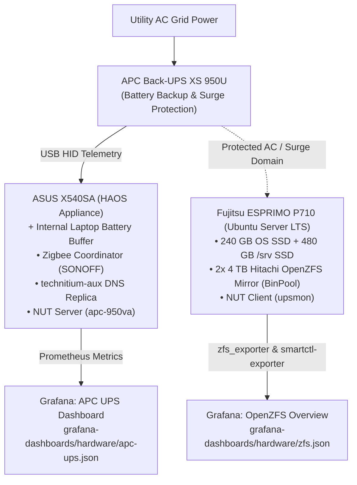

# Power Outage, UPS Telemetry & Storage Health Runbook

> [!NOTE]
> **Operational Purpose:**  
> Standard operating procedures for **grid power events** monitored via the **APC Back-UPS XS 950U** on Home Assistant OS, post-outage primary server boot recovery, **OpenZFS mirrored pool scrubbing (`zpool status -v` / `zpool scrub`)**, **S.M.A.R.T. drive diagnostics**, and **PostgreSQL 18 `--data-checksums` verification**.  
> **Navigation:** [`Runbooks Index`](README.md) · **Related Architecture:** [`ADR-005`](../adr/ADR-005-decouple-smart-home-haos-appliance.md) · [`ADR-001`](../adr/ADR-001-centralized-postgresql-18.md) · [`compose/prom-exporters/`](../../compose/prom-exporters/) · [Dashboards](../../grafana-dashboards/README.md)

---

## ⚡ Dual-Host Power & Fault-Domain Architecture



**Why this matters:**
- **Smart Home & Auxiliary DNS Continuity ([ADR-005](../adr/ADR-005-decouple-smart-home-haos-appliance.md)):** Even if the primary compute tower powers off during a prolonged outage or manual maintenance, the **ASUS X540SA** retains its **built-in laptop battery** on top of the UPS — preserving household Zigbee lighting control, UPS telemetry, and `technitium-aux` LAN DNS.
- **End-to-End Storage Integrity:** After any unexpected power loss or brownout, OpenZFS metadata/block checksums and PostgreSQL 18 `--data-checksums` provide deterministic proof that zero silent data corruption occurred.

---

## 🔌 Procedure 1: Grid Power Event Response & Automated NUT Graceful Shutdown

### 1. Real-Time UPS Telemetry (Home Assistant & Grafana)
- Open Grafana **Hardware -> APC UPS Dashboard** ([`apc-ups.json`](../../grafana-dashboards/hardware/apc-ups.json)) or the Home Assistant UI to inspect:
  - Input line voltage (`V`)
  - UPS battery charge percentage (`%`) & estimated runtime remaining (`seconds` / `minutes`)
  - Real-time power load percentage (`%`)

### 2. Automated Graceful Shutdown via Network UPS Tools (NUT Server & Client)
During a sustained power outage, shutdown of the primary compute tower (**Fujitsu ESPRIMO P710**) is **fully automated** via Network UPS Tools (NUT) to prevent dirty unmounts and data corruption:

1. **NUT Server on HAOS (ASUS X540SA):**
   - The **APC Back-UPS XS 950U** connects directly via USB to the ASUS X540SA appliance.
   - Home Assistant OS runs the NUT Server with driver `usbhid-ups` and the following tuned battery threshold overrides:
     ```yaml
     devices:
       - name: apc-950va
         driver: usbhid-ups
         port: auto
         config:
           - pollinterval=15
           - maxretry=3
           - ignorelb
           - override.battery.charge.low = 65
           - override.battery.runtime.low = 300
     ```
2. **NUT Client on Ubuntu Server (`upsmon`):**
   - The Fujitsu ESPRIMO P710 runs `nut-client` (`upsmon`), monitoring the `apc-950va` UPS over the internal network.
   - **Shutdown Trigger Thresholds:**
     - Battery charge drops to **65%** (`override.battery.charge.low = 65`), OR
     - Estimated runtime drops to **300 seconds (5 minutes)** (`override.battery.runtime.low = 300`).
   - When either threshold is breached, NUT signals a low battery condition (`LOWBATT`) and executes `SHUTDOWNCMD`:
     - Systemd signals Docker to gracefully stop all running containers.
     - Centralized **PostgreSQL 18** flushes its write-ahead log (WAL) and creates a clean shutdown checkpoint.
     - OpenZFS unmounts datasets cleanly and exports **`BinPool`**.
     - Host powers off safely before battery depletion with zero bit rot or page corruption.
3. **Power Isolation Buffer:**
   - Because the **ASUS X540SA** laptop has its own internal battery on top of the UPS, it easily outlasts the shutdown period—keeping **Home Assistant Core**, **Zigbee lighting mesh**, and **`technitium-aux`** LAN DNS resolution operational for household members throughout the blackout.

### 3. Manual Immediate Shutdown Fallback
If an operator is physically present and knows a blackout will be prolonged, the primary server can be shut down manually before the 65% threshold:
```bash
sudo shutdown -h now
```

---

## 🖥️ Procedure 2: Post-Outage Primary Server Boot & Service Audit

Once utility power stabilizes and the **Fujitsu ESPRIMO P710** boots back into Ubuntu Server LTS:

1. **Check host uptime, NTP clock sync, and external Docker networks:**
   ```bash
   uptime
   timedatectl status
   docker network ls | grep -E "traefik_network|postgres_network|monitoring_network|servarr_backend"
   ```
   *(Verify clock synchronization — DNSSEC validation on `dns.205hlab.com` and TOTP/OIDC tokens in Authentik require accurate system time.)*

2. **Identify any unhealthy or non-running containers:**
   ```bash
   docker ps -a --format "table {{.Names}}\t{{.Status}}\t{{.State}}" | grep -v "Up .* (healthy)"
   ```
   Confirm core dependency startup order (`traefik`, `postgres`, `databasus`, `authentik`, `technitium`) came up cleanly.

3. **Verify DNS Catalog Zone re-synchronization with `technitium-aux`:**
   Follow Procedure 2 in [`dns-failover-and-sync.md`](dns-failover-and-sync.md#-procedure-2-auditing--forcing-rfc-catalog-zone-synchronization) if SOA serials drifted while primary was offline.

---

## 🗄️ Procedure 3: OpenZFS Mirrored Pool (`BinPool`) Audit & Bit-Rot Scrubbing

The **2× 4 TB Hitachi Enterprise HDDs** operate as an OpenZFS mirrored pool named **`BinPool`** for media, backup archives, and persistent bulk storage. After any unclean shutdown or power brownout, verify zero vdev or checksum errors:

1. **Inspect current ZFS pool health and error counters:**
   ```bash
   zpool status -v BinPool
   zpool list BinPool
   ```
   Confirm pool state is **`ONLINE`** and **`READ`**, **`WRITE`**, and **`CKSUM`** error columns read `0` on both mirrored disks.

2. **Launch a post-outage (or monthly scheduled) OpenZFS scrub:**
   ```bash
   sudo zpool scrub BinPool
   ```
   Monitor scrub progress:
   ```bash
   zpool status BinPool
   ```

3. **Verify via Grafana Telemetry:**
   - Check [`grafana-dashboards/hardware/zfs.json`](../../grafana-dashboards/hardware/zfs.json) (fed by `zfs-exporter` in [`compose/prom-exporters/`](../../compose/prom-exporters/)) for ARC hit ratios, pool state, and error counters.

---

## 🩺 Procedure 4: Drive S.M.A.R.T. & PostgreSQL 18 Data Checksum Audit

### 1. Audit Physical SSDs & Mirror HDDs via `smartctl`

Inspect S.M.A.R.T. attributes across the OS SSD (`240 GB Kingston A400`), Docker `/srv` SSD (`480 GB ADATA SU630`), and both `4 TB Hitachi` mirror drives in `BinPool` (also exported to Prometheus by `smartctl-exporter` on port `:9633`):

```bash
lsblk -d -o NAME,MODEL,SIZE,ROTA
sudo smartctl -H /dev/sdX
sudo smartctl -A /dev/sdX | grep -iE "Reallocated|Pending|Uncorrectable|Wear|Temperature|Power_Cycle"
```

Red-flag thresholds requiring immediate drive replacement prep:
- `Current_Pending_Sector > 0`
- `Offline_Uncorrectable > 0`
- Rising `Reallocated_Sector_Ct` or `UDMA_CRC_Error_Count` (check SATA cable seating/power splitter).

### 2. Verify PostgreSQL 18 Page-Level Data Checksums (`--data-checksums`)

Production `postgres` (`compose/postgres/`) initializes with `POSTGRES_INITDB_ARGS=--data-checksums` ([ADR-001](../adr/ADR-001-centralized-postgresql-18.md)), while `databasus-verifier` (`compose/databasus/`) independently verifies recoverability against ephemeral containers. Confirm zero SSD page corruption occurred during an abrupt power event:

```bash
docker exec -it postgres psql -U "$POSTGRES_USER" -d postgres -c \
  "SELECT datname, numbackends, checksum_failures, checksum_last_failure FROM pg_stat_database ORDER BY datname;"
```

- **Expected result:** `checksum_failures` = `0` (or `NULL` if untouched) across every database row.
- **If `checksum_failures > 0`:** Stop the affected application stack immediately and execute **Scenario 2** in [`disaster-recovery.md`](disaster-recovery.md#-scenario-2-single-application-production-database-rollback) to restore the clean pre-corruption Databasus snapshot after resolving underlying SSD faults.

---

## ✅ Post-Outage Sign-Off Checklist

- [ ] Ubuntu Server boot complete, NTP time synced, and all 22 Compose stacks healthy (`docker ps`).
- [ ] `zpool status -v BinPool` reports **`ONLINE`** with `0` Read/Write/Checksum errors across both 4 TB Hitachi HDDs (and post-outage `zpool scrub BinPool` clean).
- [ ] S.M.A.R.T. attributes healthy across all 4 SATA drives (`smartctl-exporter`).
- [ ] PostgreSQL 18 `pg_stat_database` reports `checksum_failures = 0` across all tenant databases.
- [ ] APC UPS battery recharging normally in [`grafana-dashboards/hardware/apc-ups.json`](../../grafana-dashboards/hardware/apc-ups.json).
