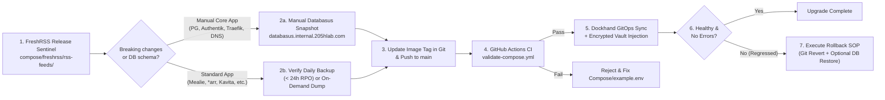

# Stack Upgrade, GitOps Release & Rollback Runbook

> [!NOTE]
> **Operational Purpose:**  
> Standard end-to-end maintenance procedure combining **FreshRSS Release Sentinel**, **Databasus pre-upgrade snapshots**, **GitHub Actions CI validation**, **Dockhand GitOps reconciliation**, fast **Git/database rollback**, and **Hawser remote observation** on HAOS.  
> **Navigation:** [`Runbooks Index`](README.md) · **Related Architecture:** [`ADR-004`](../adr/ADR-004-dockhand-gitops-continuous-deployment.md) · [CI Workflow](../../.github/workflows/validate-compose.yml) · [`compose/freshrss/`](../../compose/freshrss/) · [`compose/databasus/`](../../compose/databasus/)

---

## 🔄 End-to-End Release & Rollback Lifecycle



**Service Level Objectives:**
- **Target RTO (Stateless Image Rollback via Git Revert):** `< 5 minutes`
- **Target RTO (Failed DB Migration Rollback):** `< 15 minutes` *(paired with [`disaster-recovery.md`](disaster-recovery.md))*

---

## 📡 Phase 1: Pre-Upgrade Intelligence (FreshRSS Release Sentinel)

1. Open **FreshRSS** (`https://freshrss.205hlab.com`) and review the two curated release folders synced from [`compose/freshrss/rss-feeds/dynamic-subscriptions.opml`](../../compose/freshrss/rss-feeds/dynamic-subscriptions.opml):
   - **`205hlab - Updates`** ([`github-automatic-releases.opml`](../../compose/freshrss/rss-feeds/github-automatic-releases.opml)) — Routine application updates.
   - **`205hlab - Manual Updates`** ([`github-manual-releases.opml`](../../compose/freshrss/rss-feeds/github-manual-releases.opml)) — Core infrastructure components (**PostgreSQL**, **Authentik**, **Traefik**, **Technitium DNS**).
2. Check upstream release notes for:
   - New mandatory environment variables (requiring updates to `example.env` and Dockhand's encrypted secret store).
   - Database schema migrations or PostgreSQL extension changes (especially for Authentik, Paperless-ngx, Mealie, and Tracearr TimescaleDB).
   - Breaking Traefik v3 / OIDC redirect URI changes.

---

## 💾 Phase 2: Pre-Upgrade Backup Snapshot

> [!IMPORTANT]
> Never upgrade **Authentik**, **Paperless-ngx**, **Mealie**, **FreshRSS**, **Reactive Resume**, **Servarr**, or **PostgreSQL** minor versions without confirming a fresh backup snapshot exists.

1. Open **Databasus** (`https://databasus.internal.205hlab.com`).
2. Locate the target database on `postgres` (`205hlab-pgdb`) and trigger an **on-demand pre-upgrade backup**.
3. If upgrading a non-PostgreSQL stateful workload (e.g., `tracearr-timescaledb` or `jellyfin`), confirm its storage volume backup before proceeding.

---

## 🚀 Phase 3: Git Commit, CI Gate & Dockhand GitOps Deployment

1. **Edit the pinned version tag** in `compose/<stack>/compose.yaml` (and update `compose/<stack>/example.env` if new variables were introduced).
2. **If new secrets/env vars are needed:** Add the encrypted values in **Dockhand** (`https://dockhand.internal.205hlab.com`) **before** syncing, so Dockhand injects them cleanly without missing `${VAR:?error}` failures.
3. **Commit and push** changes to `Dr20Ervin/205hlab` (`main`):
   - GitHub Actions ([`.github/workflows/validate-compose.yml`](../../.github/workflows/validate-compose.yml)) automatically runs [`prepare-test-env.py`](../../.github/scripts/prepare-test-env.py) and `docker compose config --quiet` across all stacks.
   - Confirm the CI badge / Step Summary shows **Passed** before applying.
4. **Reconcile via Dockhand:** Either wait for Dockhand's scheduled GitOps poll or click **Sync / Pull & Redeploy** in the Dockhand UI for immediate controlled rollout.
   *(Note: For critical core upgrades — PostgreSQL, Traefik, Authentik, Technitium — prefer manual supervision while watching logs.)*

---

## 🩺 Phase 4: Post-Deploy Verification

1. **Verify container health & logs:**
   ```bash
   docker ps --filter "name=<container_name>"
   docker logs --tail 100 -f <container_name>
   ```
   Confirm Docker status transitions to `healthy` (all stacks enforce `healthcheck` gates) and zero migration tracebacks appear.
2. **Verify Edge Ingress & SSO:** Load the service URL in a browser and confirm login via Authentik works cleanly.
3. **Verify Telemetry in Grafana (`https://grafana.205hlab.com`):**
   - [`cadvisor-dashboard.json`](../../grafana-dashboards/core/cadvisor-dashboard.json) — Ensure RAM usage stays safely below the service's `deploy.resources.limits.memory` cap (preventing OOM kills).
   - [`traefik.json`](../../grafana-dashboards/core/traefik.json) — Ensure HTTP `4xx`/`5xx` error rates remain nominal.

---

## ⏪ Phase 5: Fast Rollback Procedures

### Case A — Stateless Container or Non-Breaking Image Regression (`RTO: < 5m`)

Use when a container fails healthchecks or hits a UI/runtime bug **without** altering database schemas:

1. **Revert the version bump commit locally and push:**
   ```bash
   git log -n 5 --oneline
   git revert <commit-sha>
   git push origin main
   ```
2. Trigger a manual **Dockhand Sync** (or run `cd /opt/205hlab/compose/<stack> && docker compose up -d` if operating in offline break-glass mode).
3. Verify the container returns to `healthy` on the previous image tag.

### Case B — Failed or Incompatible Database Schema Migration (`RTO: < 15m`)

Use when the new version ran an irreversible SQL migration or corrupted application tables:

1. **Immediately stop the broken application container** so no further writes occur:
   ```bash
   cd /opt/205hlab/compose/<stack> && docker compose stop <service>
   ```
2. **Restore the Phase 2 pre-upgrade database backup** by following **Scenario 2 (Single-Application Production Database Rollback)** in [`disaster-recovery.md`](disaster-recovery.md#-scenario-2-single-application-production-database-rollback).
3. **Revert the image tag** in `compose/<stack>/compose.yaml` (`git revert <commit-sha>`), sync via Dockhand, and restart the container cleanly on the prior version.

---

## 🖥️ Phase 6: Remote HAOS Observation via Hawser Agent (`standard v0.2.52`)

The auxiliary **ASUS X540SA** running **Home Assistant OS (HAOS)** reports to Dockhand via **Hawser (`standard v0.2.52`)**:
- **Permitted Operations:** Inspect container status (`technitium-aux`, Home Assistant Supervisor/Core add-ons), tail live logs, check resource usage, and restart unhealthy containers during troubleshooting.
- **Boundary Rule ([ADR-004](../adr/ADR-004-dockhand-gitops-continuous-deployment.md)):** Do **not** configure Dockhand GitOps stack sync targeting HAOS; Home Assistant Supervisor exclusively owns add-on upgrades and compose lifecycles on the auxiliary node.
