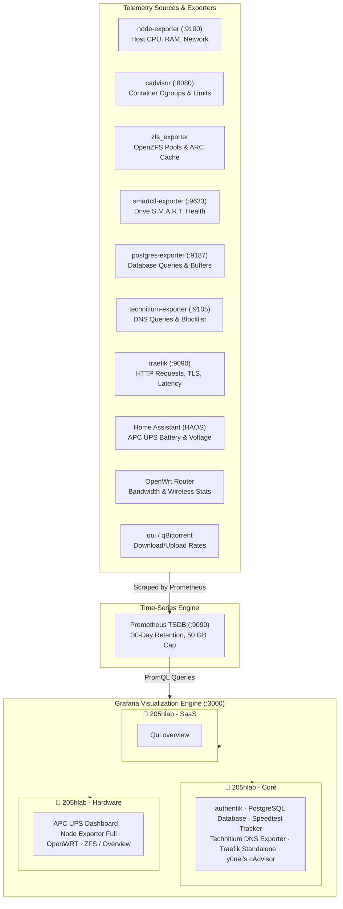

# Grafana Dashboards — Production Observability & Telemetry

This directory houses the version-controlled JSON exports of the **11 production Grafana dashboards** powering the observability stack for `205hlab`. 

Dashboards in this homelab are managed and imported directly within the Grafana web interface. Some were built from scratch for custom homelab telemetry, while others are community-created dashboards modified, tuned, and tailored to match the specific Prometheus metrics, labels, and hardware layout of this server.

The JSON files stored in this repository serve as a version-controlled backup and disaster-recovery archive adhering to Grafana's modern `dashboard.grafana.app/v2` schema.

---

## 🏗️ Observability Architecture

---

## 📁 Grafana Folder Organization & Master Inventory

In the Grafana interface, dashboards are organized into three dedicated folders: **`205hlab - Core`**, **`205hlab - Hardware`**, and **`205hlab - SaaS`**.

| Grafana Folder | Dashboard Name (in UI) | File Path | Provenance | Telemetry Source | Key Indicators |
| :--- | :--- | :--- | :--- | :--- | :--- |
| **`205hlab - Core`** | **authentik** | [`core/authentik.json`](core/authentik.json) | Community (Tuned) | Authentik `/metrics` | Task errors, worker throughput, stage execution latency, active logins |
| **`205hlab - Core`** | **PostgreSQL Database** | [`core/postgresql-dashbaord.json`](core/postgresql-dashbaord.json) | Custom / Modified | `postgres_exporter` | Transaction rates, buffer cache hit ratio, active locks, connection pool stats |
| **`205hlab - Core`** | **Speedtest Tracker** | [`core/speedtest-tracker.json`](core/speedtest-tracker.json) | Custom / Modified | `speedtest-tracker` | WAN download/upload trends, ping latency, jitter, historical test runs |
| **`205hlab - Core`** | **Technitium DNS Exporter** | [`core/technitium-dns-dashbaord.json`](core/technitium-dns-dashbaord.json) | Community (Tuned) | `technitium-exporter` | Total query throughput, blocked malware/ad domains, cache hits, upstream latency |
| **`205hlab - Core`** | **Traefik Standalone Dashboard** | [`core/traefik.json`](core/traefik.json) | Official (Modified) | Traefik v3 (:9090) | Total HTTP requests, status codes (2xx/4xx/5xx), router latencies, config reloads |
| **`205hlab - Core`** | **y0nei's cAdvisor dashboard** | [`core/cadvisor-dashboard.json`](core/cadvisor-dashboard.json) | Community (Customized) | `cadvisor:latest` | Per-container CPU throttling, memory RSS/cache, network I/O, OOM killer events |
| **`205hlab - Hardware`** | **APC UPS Dashboard** | [`hardware/apc-ups.json`](hardware/apc-ups.json) | Custom (Homelab) | Home Assistant (HAOS) | Battery charge percentage, input line voltage, real-time power load, runtime remaining |
| **`205hlab - Hardware`** | **Node Exporter Full** | [`hardware/node-exporter-full.json`](hardware/node-exporter-full.json) | Community (Tuned) | `node-exporter:v1.8.2` | Bare-metal host CPU states, RAM breakdown, disk IOPS, TCP socket states, network rx/tx |
| **`205hlab - Hardware`** | **OpenWRT** | [`hardware/openwrt.json`](hardware/openwrt.json) | Community (Adapted) | OpenWrt router exporter | Router CPU/RAM load, WAN/LAN interface throughput, NAT connection tracking table |
| **`205hlab - Hardware`** | **ZFS / Overview** | [`hardware/zfs.json`](hardware/zfs.json) | Community (Adapted) | `node-exporter` / `zfs_exporter` | OpenZFS pool health, ARC size and hit ratio, dataset compression, vdev error counts |
| **`205hlab - SaaS`** | **Qui overview** | [`saas/qui-overview.json`](saas/qui-overview.json) | Custom / Modified | qui / qBittorrent | Active torrent counts, upload/download bandwidth, tracker status, session data |

---

## 🔍 Category Deep-Dive

### 1. `205hlab - Core` (Core Infrastructure & Application Services)

- **`authentik`**: Identity provider operational telemetry. Monitors background worker task queues, certificate expiration alerts, authentication flow durations, and token issuance.
- **`PostgreSQL Database`**: Central relational database health. Monitors connection pools across the 12+ application databases sharing the central PostgreSQL 18 instance, alerting to table bloat, slow queries, and cache misses.
- **`Speedtest Tracker`**: Audits 24/7 ISP performance. Visualizes automated Speedtest CLI runs scheduled every 3 hours (`23 */3 * * *`), isolating residential bandwidth degradation from internal streaming consumption.
- **`Technitium DNS Exporter`**: Dual-instance DNS telemetry across primary (Ubuntu Server) and auxiliary (HAOS) resolvers. Monitors query rates, DNSSEC validation, blocklist efficiency, and upstream forwarder response times.
- **`Traefik Standalone Dashboard`**: Edge reverse proxy analytics. Tracks TLS handshake performance, ForwardAuth middleware latency, Cloudflare proxy IP headers, and per-service request distribution.
- **`y0nei's cAdvisor dashboard`**: Granular visibility into Docker container behavior. Essential for verifying that containers stay within their configured cgroup memory limits (`deploy.resources.limits.memory`) without triggering kernel Out-Of-Memory (OOM) killer events.

### 2. `205hlab - Hardware` (Host, Power & Perimeter Devices)

- **`APC UPS Dashboard`**: Physical power reliability. Ingests telemetry from the APC Back-UPS unit via Home Assistant's Prometheus integration, alerting to utility power outages, voltage dips, and battery health degradation.
- **`Node Exporter Full`**: Exhaustive bare-metal host monitoring for the Ubuntu Server host. Tracks CPU states (user, system, iowait), physical disk queues, network interface drops, and system thermal sensors.
- **`OpenWRT`**: Network gateway telemetry from the custom-flashed Xiaomi Redmi Router AX6S. Tracks router CPU load, NAT translation table occupancy, and per-VLAN interface bandwidth.
- **`ZFS / Overview`**: OpenZFS storage integrity. Provides real-time visibility into the Adaptive Replacement Cache (ARC), L2ARC SSD hit rates, dirty data syncs, and scrub schedules across the media and persistent storage pools.

### 3. `205hlab - SaaS` (Household & Media Services)

- **`Qui overview`**: BitTorrent client metrics. Tracks transfer rates for qBittorrent operating inside the Gluetun WireGuard tunnel, validating that network traffic strictly routes through the VPN interface without residential IP leakage.

---

## 📥 Manual Dashboard Import & Disaster Recovery Workflow

Dashboards are imported and managed manually via the Grafana web interface. If migrating to a new host or rebuilding Grafana:

1. Log into Grafana at `https://grafana.205hlab.com`.
2. Ensure the three folders exist in Grafana:
   - Go to **Dashboards** > click **New** > **New folder**:
     - Create `205hlab - Core`
     - Create `205hlab - Hardware`
     - Create `205hlab - SaaS`
3. Click **New** > **Import**.
4. Click **Upload dashboard JSON file** and select the desired `.json` file from this directory:
   - Files in `core/` $\rightarrow$ select folder **`205hlab - Core`**
   - Files in `hardware/` $\rightarrow$ select folder **`205hlab - Hardware`**
   - Files in `saas/` $\rightarrow$ select folder **`205hlab - SaaS`**
5. Select the **Prometheus** data source when prompted.
6. Click **Import**.

---

## 🔐 Access Control & Role-Based Access Control (RBAC)

Dashboards are access-controlled via **Authentik OpenID Connect**:

| Authentik Group | Grafana Role | Permissions |
| :--- | :--- | :--- |
| `grafana_admins` | **Admin** | Full control: create, edit, delete dashboards, manage datasources and plugins. |
| `grafana_editors` | **Editor** | Can edit existing dashboards, save custom panels, and adjust view ranges. |
| `grafana_viewers` | **Viewer** | Read-only access to view metrics and live dashboards without edit permissions. |
